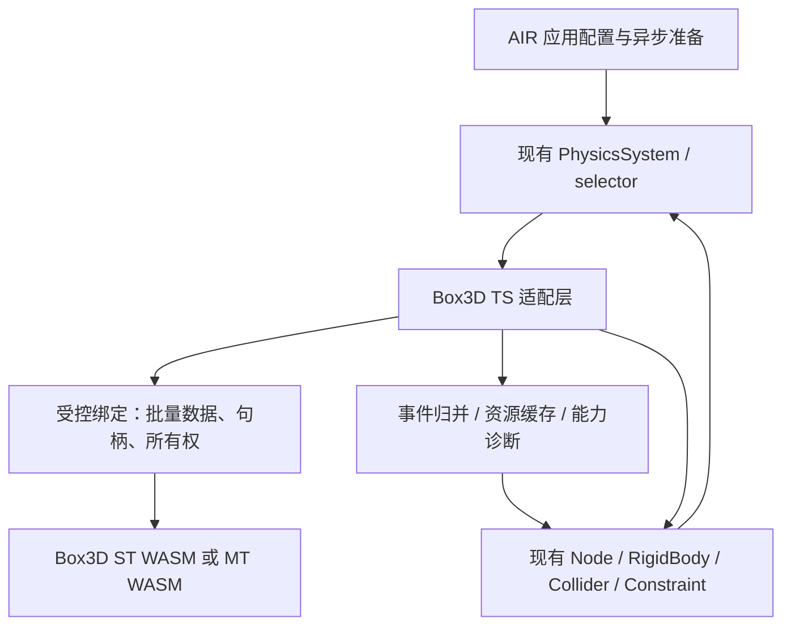

# CocosAirJS 接入 Box3D 开发计划书

**文档版本：** 1.2  
**编制日期：** 2026-10-20  
**修订日期：** 2026-10-21  
**交付性质：** 可执行开发计划与验收契约，供开发者及 Agent 接续实施  
**当前状态：** 计划编制完成；实现、构建、浏览器运行、性能验收均未执行  
**目标定位：** 为 CocosAirJS 增加可选的 Box3D 3D 刚体物理后端，先交付单线程 WASM + SIMD，再完成多线程、角色移动及录制诊断等独立能力

> 本文的接口、目录、脚本、预算与测试阈值，除明确标注“现有”外，均为拟开发内容。所有实施任务初始状态为 `TODO`，所有验收 Gate 初始状态为 `NOT_RUN`。源码阅读证明接口和实现路径存在，不等于接入已经完成。

**v1.1 修订：** 增加 EX09《AIR 礼物工坊》业务案例，以及 X / GitHub 灵感依据、完整交互规格、8 项业务验收、业务性能与独立 Agent 改版验收。同步新增 T32–T34、调整 M5 依赖、消费者范围和工期；原有任务与测试编号保留。新增内容见第 12 章，任务见第 8 章，性能与复用验收见第 13、14 章。

**v1.2 修订：** 将2026-10-21源码评估建议直接并入正文：更新主工程实施基线及2D/3D共存回归；纠正sensor连续检测边界；明确公开运动学目标/重置及EX09接合与查询路径；冻结阻尼默认映射并补非零setter、接触快照和瞬时trigger子用例；明确真机/真人责任、技术Gate与授权边界。保留35项任务、9个示例、9个Gate、91项主验收类别；新增验证全部作为既有父ID下的required子用例展开，不隐匿实际分母。本文是完整替代版计划，不是评估附录；v1.1保留归档。

## 1. 项目决策与交付目标

### 1.1 总体决策

采用“**保留现有后端，增加 Box3D 可选后端**”的方案。Box3D 首期以实验性能力交付，不替换默认 builtin，不删除 Cannon，不承诺与其他求解器逐帧轨迹一致。

接入分为两个可观察的成果：

1. **核心后端预览：** 完成初始化、刚体、碰撞体、质量与坐标转换、事件、查询、基础关节、生命周期、核心示例和可安装包验证。
2. **完整计划交付：** 在核心基础上完成多线程、胶囊角色移动、录制回放诊断、真实浏览器与目标设备性能验证、Agent 使用验收、文档和证据归档。

核心预览不能被描述为完整计划完成。对尚未通过的高级能力，能力表必须保留 `experimental` 或 `unsupported`；不得用空实现、默认 `false`、只打印警告等方式计作支持。

### 1.2 成功标准

| 目标 | 可验证结果 |
| --- | --- |
| 融入现有引擎 | 业务继续使用现有 `Node`、`RigidBody`、Collider、Constraint、PhysicsSystem，不产生第二套场景或渲染循环 |
| 补足能力 | 胶囊碰撞体、真实 shape sweep、hinge 限位与电机等声明能力有真实 WASM 数值测试和交互示例 |
| 控制接入风险 | 默认构建行为保持；选错 feature 构建或使用不支持能力时有明确错误；不静默切换后端 |
| 能实际分发 | 打包后的独立消费者可完成初始化、加载资源、模拟、切场景与关闭；类型声明与产物一致 |
| 能支撑完整业务体验 | EX09 完成引导、真实搬运、称重装箱、物理出货、失败修正和结算；可以通过配置替换商品与订单 |
| 可持续维护 | 三版本锁定、绑定升级差异表、能力清单、资源所有权表、回归测试和构建证据可追溯 |
| 可以判断是否值得采用 | 有相同工作负载下的正确性、`physicsTotal`、帧耗时、下载量、初始化耗时及内存结果 |

### 1.3 明确不在本计划范围内

- 删除现有后端、自动把已有项目迁移到 Box3D、把 Box3D 提升为默认后端。
- 完整通用 D6 / `ConfigurableConstraint` 兼容；不能完整表达的参数组合必须拒绝。
- 任意动态凹三角网格、软体、布料、流体及物理车辆成品系统。
- 在同一个 CocosAirJS 应用内公开多物理世界或运行中热切后端。
- 修改现有应用关闭后必须重新加载页面的生命周期契约。
- 原生平台、JSB、编辑器插件；本计划针对 Web 运行时。
- 网络同步、回滚净码、跨引擎轨迹一致、跨不同 ABI 的任意录制文件互通。
- 自动从 glTF 场景推导全部物理组件。

以上排除项仍要有明确的能力声明或负例测试；“拒绝不支持请求的测试通过”不等于实现了该能力。

## 2. 源码基线与现状

### 2.1 固定研究基线

| 对象 | 固定版本 | 用途 |
| --- | --- | --- |
| CocosAirJS | `02261afc53caac4cbfae483feff2948da426681a` | v1.2主工程实施基线，包含已合入的2D Box2D3 PR #8；不是Box3D已接入 |
| CocosAirJS 历史研究版 | `aaf58b147c0dc7ecabff149cf874d6877e10ef2c` | v1.0/v1.1研究来源，保留用于差异追溯，不作为本次实施checkout要求 |
| Box3D | `efca0c184d40fd6a82016983f1601c4d23965867` | 目标物理核心，保持固定 SHA |
| 社区绑定 box3d.js | `5d5a3af049cccd9948b2b55bac4342414af0ef64` | 参考与派生绑定的起点，包版本为 0.1.1 |
| 社区绑定原 vendor core | `8441b4a06d6d09dcfb0b0f704df4d847d1437b92` | 与目标 core 的差异审查起点，不能直接当目标 WASM 使用 |
| emsdk | `6.0.2` | 社区绑定使用的候选工具链，尚未验证与目标 core 的组合 |

执行时先读取实际 checkout 的 `AGENTS.md`、工作区改动和 HEAD。若主工程已推进，提交一份基线差异说明，再将任务映射到当前版本；不得覆盖用户改动或不加记录地追踪浮动 `main`。Box3D 与绑定升级作为独立变更处理。[S01][S02][S03]

**v1.2版本锁决策：** 只更新CocosAirJS实施基线，Box3D仍锁定 `efca0c184d40fd6a82016983f1601c4d23965867`，社区binding仍锁定 `5d5a3af049cccd9948b2b55bac4342414af0ef64`。2026-10-21核查时，Box3D main为 `f36d061ba26998c87cb7dc593a4065aaa03fb7eb`，比目标多一个CMake改进提交；本计划不自动吸收它。若实施中确需升级，须单列core/构建/ABI差异、重建并重跑受影响契约，不能直接跟随main。社区vendor `8441b4a…` 到目标core相差40个提交，含API改名、hash宽度、contact及cooked布局变化；T04–T07是既定技术验证，不是换一个WASM文件。[S33][S34]

T00的差异说明必须单列新2D Box2D3路径：`physics2D`配置、`loadBox2D3`、PRE选择、初始化失败清理、app.close和包内资源。3D Box3D的prepare/teardown不得覆盖或误复用2D模块状态。冻结实际source身份和已持有资源，不把PR分支head误认作merge后的main。[S35]

### 2.2 对方案有约束力的现有事实

| 现状 | 对实施的直接约束 |
| --- | --- |
| AIR 公共3D后端配置目前只接受 builtin / cannon；2D是独立配置 | 修改配置类型、规范化、等价比较和错误校验，不能只注册一个 wrapper |
| `createAirApp` 具有单例准入与关闭后不可重建约束 | 在既有准入流程内合并初始化 Promise；不顺带开放多实例或重启 |
| 最终选择发生在 `Game.EVENT_PRE_SUBSYSTEM_INIT` | WASM 必须在 `game.init` 前准备好；同步事件监听器内不能临时启动未等待的异步初始化 |
| PhysicsSystem 已有固定步累计器 | 保留这一循环；Box3D 的 solver substeps 是另一层配置 |
| 默认 `maxSubSteps=1`，未在该循环中丢弃超额累计时间 | 不新增全局追帧策略；30 Hz 渲染测试必须显式给足 catch-up 上限或手动执行固定 tick |
| selector 对缺少实现的类型可能返回空对象 | Box3D 必须在使用不支持能力时明确失败，不能把空对象当接入完成 |
| Cannon 中 sweep 方法及部分 hinge 参数尚为警告占位 | Box3D 的这些能力要独立实现并验证，不能复制占位实现 |
| 现有默认 PhysicsMaterial 初始化已具备处理 | 不把历史默认材质问题重新列为当前阻塞 |
| npm 当前公开主入口及 math 入口，包名 `cocosair.js` | 第一阶段采用同一主入口的 feature 构建，不另打包一套 Cocos runtime |
| `app.releaseScene` 先执行 scope disposal，再销毁场景对象 | world 不属于 scene scope；几何引用必须活到最后一个 native shape 销毁 |
| 当前main已接入可选2D Box2D3 WASM | 保持 `physics` 与 `physics2D` 独立；初始化、失败、关闭、资源请求和tarball增加并存回归 |
| 当前RigidBody没有公开kinematic target/teleport方法，Fixed没有公开frame setter | 正式AIR扩展及连接捕获规则在M0冻结，T11/T17交付；EX09不得访问私有wrapper或native handle |

依据为 AIR 配置、bootstrap、physics selector/system、现有 Cannon wrapper 和 package 配置。[S04][S05][S06][S07][S08][S09][S10]

## 3. 范围与能力矩阵

“支持状态”是验收后的目标，当前全部尚未实现。`approximate` 表示有公开、可测量的近似；`experimental` 表示接口仍可使用，但不能升级为稳定承诺。

| 能力 | 目标状态 | 实现策略与限制 | 首个完成阶段 |
| --- | --- | --- | --- |
| static / kinematic / dynamic body | supported | 适配现有 RigidBody；明确力、目标姿态、teleport 的区别 | M2 |
| 重力、阻尼、质量、力、冲量、睡眠 | supported | 组件总质量权威；阻尼采用§6.3明确的Box3D系数语义，非零setter有required测试 | M2 |
| linearFactor / angularFactor | supported，限 0/1 | 映射世界坐标运动轴锁；连续 factor 显式拒绝 | M2 |
| box / sphere / capsule / convex | supported | box 用凸包；胶囊端点由圆柱段高度生成 | M3 |
| cylinder / cone | approximate | 默认 32 段凸包，固定生成算法及误差范围 | M3 |
| triangle mesh / heightfield | supported，限 static | 烹制碰撞数据，保留共享资源所有权 | M3 |
| dynamic / kinematic compound | supported | 同一 body 挂多个 shape | M3 |
| baked compound | supported，限 static | 独立 cooked asset；不替代动态 compound | M3 |
| plane / simplex | restricted | 非退化四面体可走 hull；无限平面及退化 simplex 明确拒绝，业务用有限静态 box/mesh | M3 |
| trigger / collision 事件 | supported | 固定 tick 归并、稳定身份、延迟销毁，处理 shape 重建 | M3 |
| raycast / sphere-box-capsule sweep | supported | closest / all 语义、过滤、触发器、法线和距离统一 | M3 |
| overlap / 凸形查询 | supported，AIR 扩展 | 不伪造已有接口；独立文档和类型声明 | M3 |
| CCD / bullet | supported，有限边界 | 不保证 bullet–bullet或通用sensor CCD；区分移动sensor与fast solid→sensor受限命中；精确判定走sweep | M3 |
| PointToPoint / Hinge / Fixed | supported | 分别映射 spherical / revolute / weld，核对全部公开 setter | M4 |
| distance / prismatic / wheel / motor / parallel / filter 等原生关节 | supported，AIR 扩展 | 用统一 handle / dispose 契约，不新建平行场景组件系统 | M4 |
| 通用 Configurable / D6 | unsupported | 不替换为 fixed 或 spherical；创建前拒绝 | M4 |
| 胶囊角色移动 | experimental | 实现 slope / step / grounding / platform 策略，单独验收 | M6 |
| box character controller | unsupported | 当前胶囊 mover 不能伪装为通用 box controller | M6 |
| 多线程 WASM | experimental | 独立 MT 产物；环境、线程数及资源检查通过才启用 | M6 |
| 录制、回放、确定性诊断 | experimental | 同 ABI / 版本契约；不是任意时间点恢复或 rollback | M6 |
| spinningFriction、未映射参数 | restricted | 默认 0 可接受；非零且无准确映射时明确拒绝 | M3 |

Box3D 目标源码提供多种 shape / joint / query，但 static mesh、sensor、角色 mover 和 recording 都有边界；必须以固定版本头文件与实现为准。[S02][S11][S12][S13]

## 4. 架构与构建方案

### 4.1 运行时结构



仅创建一个 CocosAirJS PhysicsSystem 和一个应用物理 world。Box3D 内部的高性能数据布局保留在 WASM；业务侧仍操作 Cocos 节点与组件。节点更新、事件、资产和原生资源在 TS 适配层汇合。

### 4.2 feature 与分发选择

新增 `physics-box3d` feature。初期默认构建继续包含原有 builtin / Cannon；Box3D 预览构建在同一主模块内加入新 adapter，WASM 与 worker 作为独立资源按需加载。

- feature 模块在同一 runtime 中登记轻量 descriptor / prepare callback；导入时不能请求 WASM。
- bootstrap 先完成现有应用准入，再等待所选后端准备，最后进入 `game.init`。

- 2D/3D使用同一应用准入下的独立prepare状态与清理记录。v1.2推荐顺序为所选2D准备→所选3D准备→game.init；prepare也必须被初始化事务的try/catch覆盖，不能把加载放在清理边界之外。2D失败时不得启动3D；3D失败时释放本次已取得的2D资源；game.init失败时清理双方。若M0确有依据改为并行，需记录决定、等待已启动任务收敛或代际失效，并覆盖两个完成顺序及失败后晚到；不能留下半个应用。[S35]
- 同步的 PRE_SUBSYSTEM_INIT 阶段只做最终 backend 选择，不再承担异步加载。
- 未包含 Box3D feature 的构建遇到 `physics: 'box3d'` 应返回 `AIR_E_PHYSICS_BACKEND_UNAVAILABLE`。
- 包含 feature 的构建选择 builtin / cannon 时，Box3D WASM、MT worker 请求数必须为 0。
- 同一个消费者只安装、导入一份完整主 runtime。禁止把独立打包的 Node / selector / PhysicsSystem 插件再挂到另一份 runtime 上。
- 使用当前包名 `cocosair.js` 产生本地 prerelease tarball；版本由执行时 package 基线派生。第一轮仅 pack 与安装验证，发布 npm 不属于本计划自动执行范围。
- `build:dts` 与 `AIR_OUT_DIR` 的关系必须专门处理；不能把默认构建的声明文件误装进 Box3D variant。

### 4.3 拟新增与修改的目录

下列路径是实施目标，创建前检查当前目录结构，不覆盖已有同名实现。

| 路径 | 职责 | 主要负责人 |
| --- | --- | --- |
| `src/air/physics/box3d/` | world、body、shape、joint、事件、查询与诊断适配 | Adapter |
| `src/air/physics/box3d/binding/` | 经过版本审查的低层 facade、静态 reader、类型 | Binding |
| `src/exports/physics-box3d.ts` | feature 注册与 AIR 扩展导出 | Integrator |
| `vendor/box3d/` | core 来源清单、patch 或仓库现行 vendor 方式 | Binding |
| `tools/physics/box3d/` | 锁文件、宿主 CMake、构建、契约测试辅助 | Binding |
| `tools/verify/box3d/` | 测试 inventory、真实运行、证据汇总 | QA |
| `tools/benchmark/box3d/` | 可复现的场景、预算与采样 | QA |
| `examples/box3d-*` | 9 个内容完整的示例；核心为EX01–EX06、EX09 | Examples |
| `docs/physics/box3d/` | 使用、能力、迁移、维护、故障处理 | Integrator |
| `build/physics/box3d/{st,mt}/` | 生成的 loader、WASM、worker、manifest | Build |
| `src/air/physics-backend.ts`、`app-config.ts`、`bootstrap.ts`、`app.ts` | 配置、准备、最终选择与 app 级 teardown hook | Integrator 独占 |
| `src/cc.config.json`、构建脚本、`package.json` | feature、声明、资产复制、tarball | Integrator 独占 |
| `docs/upstream-file-map.json`、`UPSTREAM.md`、license 清单 | 来源与修改归档 | Integrator 独占 |

新增脚本的命名在 M0 冻结。本文提到的 `verify:box3d:*`、`build:box3d` 等均是待创建命令；不得在实施记录里声称当前已经存在。

## 5. 接口契约

### 5.1 应用配置草案

```ts
// 拟新增配置，需与当前 AirAppOptions 合并并生成声明。
const app = await createAirApp({
    canvas,
    physics: 'box3d',
    physicsOptions: {
        box3d: {
            assetBaseUrl: '/physics/box3d/',
            threading: 'single',
            solverSubSteps: 4,
        },
    },
});
```

| 字段 | 契约 |
| --- | --- |
| `physics` | 扩展联合类型为 builtin / cannon / box3d；默认值不变 |
| `assetBaseUrl?: string` | 默认由构建 manifest 定位；子路径与显式 URL 均测试；不硬编码仓库开发地址 |
| `threading?: 'single' \| 'multi' \| 'auto'` | 默认 single；auto 仅选择同版本 Box3D 的线程变体 |
| `workerCount?: number` | 表示总执行线程数，包含调用线程；single 仅允许省略或 1，multi 允许 2…manifest 上限 |
| `solverSubSteps?: 1 \| 2 \| 4 \| 8` | 默认 4；这是一次固定物理步内部的细分数量 |

初始 manifest 设计值为 `preferredWorkerCount=4`、`maxWorkerCount=4`，即最多 3 个后台 pthread。该数值是资源限制，不是性能结论。配置规范化、幂等比较、重复 create、并发 prepare 和失败后的状态必须一起修改。

`auto` 只在隔离环境、SAB、Worker / pool 初始化等已声明条件不满足时回退 ST，并暴露 `requestedMode / selectedMode / fallbackReason`。ABI 或 hash 不匹配、非法参数、模拟崩溃不能触发正常回退；不能改用 builtin、Cannon 或旧版 core。

### 5.2 能力与错误

拟提供只读 `getPhysicsBackendInfo()` AIR helper，输出选中后端、有效线程配置、source/build identity、capabilities 及回退原因。确切导出名在 M0 的 API 表冻结。对业务不暴露裸指针，不把 native handle 用作永久 collider 身份。

每项能力必须携带 `supported / approximate / experimental / unsupported`、限制条件、关联测试 ID。创建、属性 setter、运行时重建三条路径都要校验。建议错误码：

| 错误码 | 触发场景 |
| --- | --- |
| `AIR_E_PHYSICS_BACKEND_UNAVAILABLE` | 所选构建没有 Box3D feature |
| `AIR_E_BOX3D_ASSET` | loader / WASM / worker 获取或完整性失败 |
| `AIR_E_BOX3D_ABI` | core / facade / schema / artifact 不一致 |
| `AIR_E_BOX3D_UNSUPPORTED` | 不支持的 shape、joint、参数或动态 mesh |
| `AIR_E_BOX3D_CONFIG` | 非法 workerCount、substeps、尺寸、质量等 |
| `AIR_E_BOX3D_THREADS` | 显式 MT 条件不满足或 pool 准入失败 |
| `AIR_E_BOX3D_COOKING` | 几何退化、超限或烹制失败 |
| `AIR_E_BOX3D_DISPOSED` | 使用已销毁的扩展对象或句柄 |

沿用现有日志与错误风格，不泄露业务数据。错误包含操作、对象逻辑 ID、能力名及可行处理方式；发生失败后不得留下半创建 native 对象。

### 5.3 正式运动控制扩展与M0冻结产物

以下是v1.2的**拟定默认API**，不是当前已经存在的入口。T01/T03须输出 `docs/physics/box3d/api-contract.json`（最终命名可按仓库规则统一）及对应公开TypeScript签名、错误/生命周期表、API-to-test映射；T11实现，T22的d.ts与消费者验证。若发现命名冲突，只能在M0统一改名并同步本文/示例/测试，不能让不同工作流各自实现接口。

| 拟定入口 | 默认契约 | required验收 |
| --- | --- | --- |
| `createKinematicTarget(body)` | 仅接受当前app/world中有效且已初始化的kinematic RigidBody；每body最多一个活动handle；非Box3D/错误body类型明确拒绝 | C11-TARGET-CREATE |
| `handle.setTarget({ position, rotation })` | 输入为body origin的世界姿态，复制输入；有限四元数规范化；排入下一个可执行固定tick，采用一次目标而非持久速度 | C11-TARGET-TICK-BASIC / C11-TARGET-TICK-EVENTS |
| `handle.clear()` / `handle.dispose()` | clear取消未消费目标并在安全点清零该target模式的线/角速度；dispose再释放控制权，重复dispose安全；失效handle的setTarget明确报错 | C11-TARGET-LIFETIME-BASIC / APP / FULL |
| `teleportRigidBody(body, pose, { preserveVelocity, wake })` | 正式AIR显式重置入口；默认preserveVelocity=false、wake=true；在安全点提交并取消该body待消费target；支持有效dynamic/kinematic body，不用于正常搬运 | C11-TELEPORT |

这组扩展不新增场景/物理循环，也不改旧后端API。v1.2默认将target命令的消费点放在现有 `world.step` 内：scene同步完成→调用正式before-step hook→合并本tick命令→上传native→恰好一次 `b3World_Step`。同一handle同tick多次setTarget按命令序号最后一次生效；在事件回调中提交只影响下一tick。target按当前固定dt产生到达速度，不直接调用SetTransform；未提交新target的下一tick归零target速度，不无限沿用上次速度。限速/加速度由EX09控制层在提交target前约束，不能修改被持商品速度来伪造约束。

活动target handle独占该kinematic body的运动控制：公共setLinearVelocity/setAngularVelocity和直接Node姿态修改与target模式冲突时，默认返回AIR_E_BOX3D_CONFIG，组件/native保持最后有效状态；clear仅取消目标并保留target控制权；必须dispose后才转入速度模式，显式teleport是唯一允许的重置通道并取消pending target。适配层内部设置到达速度不经业务冲突入口。body禁用、切为非kinematic、所属scene释放或app关闭时撤销pending命令并使handle失效；pause清空pending目标及移动意图，恢复后须重新提交。paused时新target默认拒绝而非积压。persist body按其真实所有权保留，不因其他scene释放误失效。T01必须对照现行Node同步可实现性冻结上述处理路径，不能在T33临时绕过。

EX09通过该公开target、公开FixedConstraint、公开all查询和公开teleport完成业务；接合姿态及排除规则见§12.5。若M0发现需要修改默认契约，记录设计原因和受影响required子例即可由主Integrator复核，不为普通技术决策增加逐阶段用户审批。

## 6. 物理语义与生命周期契约

### 6.1 时间与步进

保持现有顺序：`syncSceneToPhysics → world.step(fixedTimeStep) → emitEvents → syncAfterEvents`。每次 `world.step` 只调用一次 `b3World_Step(world, dt, solverSubSteps)`。[S07][S11]

- 不新增 RAF、独立累计器或偷偷乘以 substeps 的模拟时间。
- 现有 `maxSubSteps` 控制每个渲染帧最多执行多少次固定步；Box3D 的 `solverSubSteps` 控制一个固定步内部求解，两者分别记录。
- 现有累计时间在达到 catch-up 上限后保留；本项目不对所有后端新增丢时或 delta clamp。长帧测试检查当前累计行为和单帧上限。
- 30 / 60 / 120 Hz 对照测试显式配置足够的 `maxSubSteps`，只比较相同 600 个逻辑 tick；不要求默认 maxSubSteps=1 在 30 Hz 渲染下自动追平。
- 每次普通 `applyForce/applyTorque` 调用贡献到下一个可执行固定 tick，同一 tick 的多次调用相加；消费后不当作永久力。一次性冲量使用命令序号去重，不因 catch-up 重复消费，也不把 BEFORE_PHYSICS 的帧级回调当作逐 tick 回调。
- 新增后端局部的 before-step hook / 持续力 handle，明确 enable/disable/dispose，以相同 tick 命令流驱动跨渲染频率一致性测试及示例；不改变现有 Director 事件频率。
- 当前 `ConstantForce.lateUpdate` 是帧级施力，保持其现有调用行为，另测不同渲染频率下的实际提交次数并写入迁移文档。不能宣称它天然提供相同逐 tick 输入，不能把普通 applyForce 偷偷变成永久力。[S19]
- 渲染插值只能读取 previous/current pose；不得将插值结果回写 native dynamic body。初期可以不提供插值，不能把它作为刚体正确性的前提。

### 6.2 坐标、变换与运动控制

- Box3D 内部使用 m、kg、s、rad。现有 Cocos 公共单位保持：Hinge lower/upperLimit 为 degree，motorVelocity 按公开文档为 degree/s，角色 slopeLimit 为 degree；在适配边界转换为 native rad/rad/s。旧后端 motor 换算差异单独记录，不照抄也不修改。新增 AIR 参数逐项注明单位。[S20]
- 保持 Cocos 当前坐标约定，不擅自更换 up axis 或手性。
- Node world pose 对应 body origin；COM 偏移用于动力学，不能把渲染节点移到质心上。
- adapter 的动态姿态回写标记独立 epoch，防止下一 tick 把自身回写再次当作 teleport。不得清除其他系统依赖的 Node dirty flags。
- `applyForce/applyImpulse(F, relativePoint)` 的第二参数是相对 world COM 的世界空间偏移；native 若要求绝对作用点，传 `p=worldCOM+relativePoint`。local 版本令 `F_world=R·F_local`、`offset_world=R·localOffset`，再传 `p=worldCOM+offset_world`。localOffset 只旋转，不再乘 Node scale 或加 body origin 平移；省略第二参数等价于在 COM 施加。[S19]
- kinematic的速度控制、target和teleport按§5.3执行；默认target handle独占控制、冲突拒绝、一次目标在固定tick消费，不能悄悄叠加或将Node逐帧写姿态伪装为连续运动。
- 显式teleport采用§5.3公开选项，默认清线/角速度并唤醒；移动父节点、修改scale、target期间的Node修改和恢复流程必须测试。
- 一般剪切矩阵及退化 scale 在 native 创建前拒绝。有限静态 mesh 可把允许的非均匀缩放、镜像烘焙到顶点并修正 winding。
- sphere / capsule / cylinder / cone 的非均匀缩放兼容当前动力学后端及公开 capsule 语义，并标明圆截面近似，不生成椭球。sphere 半径乘三个轴绝对缩放的最大值；另外三类半径乘垂直轴最大绝对缩放，高度/圆柱段乘轴向绝对缩放。capsule 的 `height=2r+cylinderHeight`；零圆柱段可退化为球。[S14][S21]
- 尺寸使用绝对缩放，但 collider center 仍按带符号的局部变换处理镜像。adapter setter 回读组件已规范化的尺寸，不能盲信仍可能为负的回调形参。正常尺寸不得用任意 epsilon 改写，最小尺寸规则在 M0 明确；不虚构 Sphere/Cylinder/Cone 上不存在的 worldRadius/worldHeight getter。

### 6.3 质量、质心、惯量与材质

- `RigidBody.mass` 是目标总质量，进入 native 前必须为有限正数。现有公共 setter 会把非正值规范化到 0.0001，因此公共测试检查规范化结果；raw binding 负例才要求拒绝原始非法值。NaN/+Infinity 必须拦截；属性先写后回调时，adapter 用受控回写和重入保护恢复最后有效组件值，native 状态保持不变，随后报告错误。[S19]
- 根据非 sensor 有效几何计算相对质量分布，再归一到组件总质量。允许先 addComponent(RigidBody)、后添加 collider 的正常组装：质量计算延迟到安全提交/首次有效 step，无几何时保持 pending，不在 onLoad 立即拒绝；提交时仍缺有效几何才报告明确错误。
- 复合体先求总 COM，再用平行轴定理求 COM 处惯量；Box3D `b3MassData.inertia` 必须按 COM 处张量传入。
- collider center、local rotation、允许的 scale 都参与质量计算。动态 shape 重建保持目标总质量；COM / inertia 改变需有确定规则。
- sensor 默认不参与质量分配。若 dynamic 没有实体 shape，则使用同一 body 的非退化 sensor 几何计算质量分布，并公开这个 fallback；若无有效几何，则拒绝自动质量计算，不能依赖 native 隐式值。
- `isTrigger` 重建保留 body origin pose、线速度和角速度；变化后的惯量可能改变未来响应，不承诺重建瞬间动量自动守恒。大体积 trigger 不应无说明地改变混合实体的 COM。
- static anchor body 可以没有shape。dynamic的两种正常添加顺序都要通过；运行时删除最后一个有效collider后进入pending-invalid，不用默认质量继续模拟。待geometry恢复后再提交；错误明确关联该body，不损坏world内其他对象。
- `linearFactor / angularFactor` 只接受 0/1，映射世界坐标速度分量锁；不接受 0.5 等连续值，也不用 Euler 角是否恒定判断角轴锁。[S15]
- 摩擦与恢复系数映射现有 PhysicsMaterial，并监听材质更新；混合规则在 M0 对照 Cocos / Box3D 后冻结。rolling friction 与 Box3D rolling resistance 的单位及物理意义必须审查，未确认不能一比一冒充兼容。
- `spinningFriction=0` 可接受；非零且无法准确映射时显式拒绝。材质默认值不被偷偷修改，shape 默认材质与共享材质更新均验收。[S16]
- setter更新采用验证→准备→提交；公共组件已经先写字段的路径须回滚最后有效值并防重入。共享材质先验证所有受影响shape再统一提交，禁止一半更新、一半拒绝。拒绝后组件读回值、native值和下一tick行为必须一致。

**阻尼与运行时setter的默认映射。** v1.2建议并由M0按真实低层fixture冻结：Box3D后端接受有限 `linearDamping/angularDamping ∈ [0,1]`，数值直接作为native阻尼系数c使用，单位按Box3D解释为s⁻¹；不隐藏转换成Cannon模式，不修改其他后端。对无外力且无陀螺耦合的fixture，每个native子步h的速度衰减为 `1/(1+h*c)`，一秒n个等长子步为 `v0/(1+c/n)^n`。c=0无衰减；c=1仍为有限衰减，**不是立即锁死/清零**。原Cocos setter在Debug仅对超出[0,1]警告，Box3D adapter须按§5.2拒绝非有限/越界输入并恢复最后有效值，公开此更严格限制。[S36]

当前锁定 `@cocos/cannon=1.2.8`、Cocos adapter直接赋值；其自由速度阻尼使用 `pow(1-d,dt)`，与Box3D相同数值不等价，d=1的端点行为更不同。迁移文档必须给出0、0.1、0.9、1的对照，禁止宣称“参数数值一致，所以衰减一致”；不把该对照强制变成跨引擎轨迹相等。推荐默认是保留组件数值并明确Box3D后端语义，而不是新增一套未验收的兼容模式。T01冻结选定映射与范围，T10以C06-DAMPING-LINEAR/ANGULAR/RUNTIME验证，修改该决定必须同时版本化映射与测试预期。

`useGravity` 映射native gravityScale=1/0；不借清速度模拟关闭重力。运行时allowSleep、sleepThreshold必须有实际native效果，阈值要求有限且非负；已初始化路径测试读回与后续行为，不伪造现有公共组件在onLoad之前可设置sleepThreshold。睡眠等待时间、唤醒影响按目标core与公共接口冻结，用C04-GRAVITY/C04-SLEEP/C36-SETTER-ROLLBACK精确验证。

### 6.4 shape、cooking 与限制

- box 的 API 全尺寸转换到半尺寸；capsule 的端点间距等于 `cylinderHeight`，不是总高度。
- cylinder / cone 默认 32 段内接凸包。冻结顶点生成顺序、轴向、上限校验与缓存 key；近似误差由测试量化。
- Cocos 尖锥使用32个底圈点加一个唯一顶点，通过 `b3CreateHull` 生成。目标源码的 `b3CreateCone` 要求两端半径都大于0，不能用零顶半径调用，也不能用任意小顶面偷换成截锥。cylinder helper 的轴向区间为 `[yOffset,yOffset+height]`，居中形状取 `yOffset=-height/2` 后再处理center/axis。32段圆柱的64顶点/34面/96完整边、尖锥的33顶点/33面/64完整边均在目标上限内。[S22]
- hull 的顶点、面、边上限分别按目标 core 常量校验；不能把“输入点数量可减少”混同于任意输出凸包合法。
- static mesh 读取所有受支持子网格并验证 index format、primitive mode 和 winding；不得照搬只读第一子网格的旧路径。
- heightfield 冻结行列顺序、X/Z 间距、Y 高度、洞及边界行为。不支持的洞或数据格式在 cooking 前失败。
- `dynamic/kinematic + triangle mesh / heightfield / baked compound` 明确拒绝；动态 compound 用多个 shape。
- cooked asset 与 source mesh 分离；key 包含 source hash、缩放、cooking 参数、core / schema 版本。
- 高密度碰撞 mesh 需要简化及候选三角形预算检查。单次凸体接触的候选容量不等于全 mesh 总三角形上限。[S12]

### 6.5 查询、过滤与事件

- 当前 Cocos 32 位 group/mask 先按无符号低 32 位转换到 Box3D；测试 bit31、`-1`、0 和动态 mask 更新。若日后开放 64 位扩展，使用 BigInt 或无损高低位，不用 JS 32 位按位运算承载高位。
- query 的 ray 长度、单位方向、closest/all、trigger、mask、距离与法线遵守现有接口。all 结果的排序与复合 shape 去重规则要写入测试；不能只返回“有碰撞”。
- `PhysicsSystem.sweepCapsule(ray, radius, height, orientation, ...)` 的height对应圆柱段/两球心距离：radius=.5、height=1表示总高2；height=0表示球形查询。orientation作用于本地Y轴胶囊，不能复制其他后端的内部轴补偿后多转90°。[S23]
- overlap 是新增 AIR 扩展，不能冒充现有 IPhysicsWorld 已经有这个接口。
- v1查询输出固定为：all按distance升序，同距按稳定logicalColliderID排序；同一collider有多个native命中只保留最近结果；closest与all第一项一致。closest/all共用generic callback收集路径，trigger被过滤后继续搜索；不能直接调用便利版CastRayClosest后丢弃trigger，因为会漏掉后方实体及零距离结果。[S26]
- 非单位方向在副本上归一化，不修改输入；距离按 `fraction×maxDistance` 计算。有限非零orientation也在副本上规范化；sweep全程只平移，姿态固定，不承诺旋转扫掠。box使用半尺寸，sphere/capsule使用半径。[S23][S27]
- 零方向或maxDistance=0返回false，all为空，不调用native；这不是overlap查询。负距离、NaN/Infinity/MAX_VALUE、非有限向量、非正半径/box半尺寸、负capsule圆柱段或零四元数在native前拒绝；转换到float后的translation仍须有限。
- 检测区间明确为 `[0,maxDistance)`，适配层过滤fraction≥1，避免各原生shape在精确终点处的差异。边界测试使用L−δ/L+δ，并把此规则写入与其他backend的差异表。
- ray从solid convex内部开始时保留distance=0、point=origin、normal=0。sweep保留native的零距离命中：该结果可受slop影响，不等于精确穿透深度，其point不必等于起点，零normal不能归一化。实际目标源码的shape cast起点重叠行为与部分头文件注释不一致，必须用真实WASM测试锁定。[S26]
- mesh/heightfield沿cooked winding采用单面查询，不读取渲染材质double-sided，不补造封闭mesh内部的体积命中；v1不提供双面cast开关。从背面开始的sweep不保证命中，哪怕其体积跨过表面。需要接触恢复应使用overlap/contact/mover。
- 保持现有公共返回约定：all入口清空结果；closest miss必须先检查boolean，不能把上次closest缓存当新命中。示例要演示正确检查顺序。[S23]
- native shape/body/joint ID 保存完整 generation / world 信息；公开事件采用稳定应用 collider ID。
- 初版为可参与sensor的convex visitor和sensor双方启用必要native sensor事件开关，再按Cocos监听状态分发。contact事件和监听器开关也显式管理；不能依赖默认关闭的flags或只开启sensor一端。[S11]
- 一个collider拆成多个native shape时按应用pair归并。有监听且持续有效接触的tick：首次恰好一次enter；之后每个仍接触的tick恰好一次stay；自然分离tick恰好一次exit且无stay。内部substeps不增加次数；睡眠不删除pair；disable后再enable且重叠则重新enter。
- 完整实现IContactEquation的local/world point/normal与isBodyA。native `anchorA/B` 是相对各COM的世界向量，重建 `worldPointA=worldCOM_A+anchorA`，再用body origin与逆旋转求localPoint；B同理。**anchor、COM、origin和rotation必须属于同一接触快照时刻。** 固定core先生成manifold再积分姿态，GetData返回缓存manifold，不能据此假定所有复用/CCD路径的anchor都属于同一时刻。v1.2推荐先采集step前后native COM/origin/rotation，由T07用真实低层旋转/偏心/复用/CCD fixture确定各路径anchor的有效基准，并把已验证的采样规则写入binding契约；必要时保存接触生成时的native姿态。默认禁止拿回调时步后Node姿态直接混算缓存anchor，也不声称缓存点是步后重新求交的精确点。T15仅使用T07已证明一致的快照规则；某路径无法确定基准则该接触子例BLOCKED，不猜测补偿或把所有路径强行归为步前。normal按native A/B与self/other关系转换，local/world getter基于同一快照；双方监听方向一致。C21-SNAPSHOT覆盖非零角速度、偏心COM和双方读取，快照复制后不因下一tick/销毁改变；不能直接把anchor当localPoint或长期引用失效native contact。[S24][S37]
- step 后先复制有效事件、接触点和必要身份，再进入业务回调；任何回调触发的销毁、重建、过滤变化均排到安全点。
- 自然分离发 exit；destroy / disable 清理 pair，不向无效对象回调，不补造“自然分离”。若 M0 发现已有公共契约明确要求另一语义，应记录兼容决定并只适配 Box3D，不能顺带修改旧后端。
- `isTrigger` 改变时，安全结束旧事件通道，重建后下一 tick 建立新通道；尺寸变化但类型未变时，按实际接触协调 pair，不能仅因 native ID 改变重复 enter。
- filter 改变时，对仍有效对象结束旧 pair 或建立新 pair；内部原因区分 `separated/typeChanged/filterChanged/removed`。
- CCD的公开保证限于已验收的dynamic–static、bullet–非bullet dynamic场景；不保证bullet–bullet，也不承诺通用sensor CCD。目标core区分world continuous与body bullet；首期world continuous启用，`RigidBody.useCCD=true`映射bullet强化，false取消bullet但不代表该body关闭dynamic–static连续检测。此映射公开为后端差异，不虚构body级continuous开关。CCD事件允许按上游语义晚一固定步；精确射击判定使用cast。[S11][S12]
- **sensor边界按实际路径描述：** 作为移动fastShape的sensor不做连续扫描；fast solid对目标sensor在双方启用sensor events等条件满足时可走TOI，并将sensor hits合入overlaps。锁定core每个连续检测上下文最多缓存8个sensor hits，还受遮挡、过滤、目标body类型及bullet路径影响，不能推广为任意sensor组合均有CCD保证。[S38]
- adapter保留native受限连续命中产生的瞬时trigger事件，不因tick终点没有几何重叠而删除enter；后续native结束时发一次exit，不补造stay或重复enter。C22-SENSOR-TRANSIENT以单次穿越fixture锁定命中tick enter、下一tick无持续重叠时exit的基线预期，同时与低层事件流对照；若真实WASM时刻与预期不同，在M3 Gate前查明并更新带版本的事件契约，不能为匹配文本伪造事件。C28-SENSOR-CCD展开solid→静态sensor、移动sensor→静态实体、双方开关、solid遮挡、容量边界等正负观察；只证明这些fixture，不把非承诺组合加入完整sensor CCD能力。EX09收货仍以完整几何越面证据为准，不能用一次trigger enter记账。

### 6.6 关节参数与断裂

P2P/Hinge/Fixed分别映射spherical/revolute/weld；按照公共单位与连接body的局部坐标转换anchors/axes。全部公开setter纳入矩阵，不能只实现构造时参数。

Fixed的 `breakForce` 为N、`breakTorque` 为N·m。Box3D阈值用于产生joint事件，不代表native自动断裂；adapter读取阈值事件后将逻辑joint标记broken，在安全点真正断开，不能下一tick自动创建回来。低于阈值、高于力阈值、高于扭矩阈值分别测试。[S25]

断裂后component仍可存在，诊断为broken；显式disable→enable或公开重建命令才重新建joint。connectedBody销毁先断开相连joint；不会自动接到复用ID。普通参数更新不复活已断joint。现有Hinge没有spring公开属性，spring仅通过新增AIR扩展配置和验收。

Fixed接合默认捕获连接安全提交瞬间的两body origin世界姿态，生成保持当前相对位姿的weld frames，不把组件未公开的anchor/frame字段暴露给案例。EX09先创建disabled FixedConstraint，设置connectedBody与enableCollision=false，再enable提交；T17须验证此公开组装顺序不会先生成临时错误连接。连接目标改变时按同一规则安全重建，不能瞬移任一body；业务吊点距离仅作为允许接合的判定，不要求Fixed物理anchor等于可见吊点。用C29-ATTACH-POSE验证非同心、非零相对旋转、连接中释放/销毁和正确禁用这一body pair碰撞。

### 6.7 world、场景与资产的生命周期

**world 属于应用，scene scope 仅拥有场景对象。** 这与现有 `releaseScene` 先 dispose scope 的次序有关；把 world.dispose 直接挂到 scene scope 会造成后续 component onDestroy 使用失效 world。[S05]

| 对象 | 所有者 | 释放条件与顺序 |
| --- | --- | --- |
| 模块 / pool | backend runtime | app 最终关闭，所有 world 与 native job 退出后 |
| 物理 world | app / PhysicsSystem | scene release 完成且已停止步进后 |
| body / shape / joint | 对应组件或扩展 handle | 安全点处理；先解除 joint、映射和 pair，再销毁资源 |
| cooked mesh / heightfield / compound | 缓存 + native shape 引用 | 最后一个 native 使用者释放，且缓存 lease 已释放 |
| hull 数据 | 按核心复制语义区分临时与持久 | 创建成功并确认核心已复制后释放临时构建内存 |
| event / contact buffers | world | 当步快照读取期间有效；回调不能持有失效 WASM view |

场景释放：阻止本次清理期间 step → 按既有流程释放 scope / scene → 处理 deferred destroy → 清空场景 pair、handle、无引用资产 → 保留可用于下一场景的 world。

现有persist node仍遵守其跨场景保留语义：对应body/shape与资产lease转入明确的持久所有权，不计入应清理的scene资源；它与被销毁scene对象相连的joint/pair需要解除。新场景开始后持久对象继续模拟。应用close才统一关闭其native handles；不能用“所有body清零”误删合法persist对象。[S05]

所有异步cooking、资产加载和延迟native创建绑定app/scene generation。release使该代际失效；晚到结果只释放临时资源，不能插入复用的world或下一场景。姿态回写epoch不能代替资源代际。

应用关闭：await scene release并检查receipt → 永久停止本应用物理step → 使所有adapter handles进入关闭态 → 有界清理world/cache/module/pool。`releaseScene()` Promise resolve不等于释放成功；receipt中的failed/pending必须保留，结合live counters判断结果，不能改写成released。任何关闭后的body/world/query调用由disposed guard拦截。通过app级teardown hook实现，不挂到scene scope。close重复调用安全；之后create仍遵守现有 `AIR_E_APP_CLOSED` / 重新加载页面契约。[S05]

WASM Memory 容量不回缩不等于泄漏。验收以 live native 对象、adapter handle、geometry 引用、live bytes 和 worker 数量为准；Memory.grow 后重建 views，vector 重新分配后刷新指针。

2D/3D并存时分别记录world、loader、WASM/pool与disposed状态，按各自所有权清理且只释放本次app取得的资源；一方失败不跳过另一方清理，也不能对尚未创建的一方伪造释放成功。I06-COEXIST-BASIC/FULL按阶段覆盖正常close、重复close与失败receipt，I03-COEXIST-PREPARE覆盖prepare和game.init失败。所有target/持续力handle的命令队列也计入生命周期计数。[S35]

## 7. WASM、绑定与资源构建

### 7.1 三版本锁与升级 Gate

建立 `tools/physics/box3d/versions.lock.json`，固定 core SHA、binding base SHA、binding 原 vendor SHA、emsdk 与构建容器 digest、编译器版本、patch hash、API schema hash、编译参数。`emsdk=6.0.2` 在真实验证前标记为候选。

顺序不可倒置：public header 差异清单 → struct / enum / callback / layout 审查 → binding 编译与真实 WASM contract tests → adapter 集成。发现工具链不兼容时可以评估并记录工具链升级，但不能为通过构建偷偷退回旧 core 或使用旧预编译 WASM。[S02][S03]

### 7.2 单线程先行

使用宿主 CMake `project` 加 `add_subdirectory(Box3D)`，避免 Box3D 作为顶层项目时自动注入 pthread 的配置。宿主必须显式给 core 和 binding 一致参数，并检查 compile commands，不能只确认一份 CMake 文本。

- C17 core，binding C++ 标准依实际需求冻结；首期 float32，`BOX3D_DOUBLE_PRECISION=OFF`。
- SIMD 开启，保留目标 SSE2 路径需要的选项；禁止 fast-math。首期目标设备需支持 WASM SIMD，标量 fallback 不在默认交付范围。
- ST 不带 pthread、shared memory 或 worker pool；普通非隔离 HTTP 页面可运行。
- ESM modularized loader，独立 `.mjs + .wasm`；不默认同时内联 ST / MT 两份。
- facade 的 runtime `new Function` 改为构建期静态生成；Emscripten 设置 `DYNAMIC_EXECUTION=0`，如使用 AOT 选项必须核实锁定 SDK 支持并实际验证。
- CSP 测试允许 `wasm-unsafe-eval`，同时禁止 JS `unsafe-eval` 与 `unsafe-inline`；这不承诺可在禁止所有 WASM 编译的策略下运行。

### 7.3 多线程独立交付

MT 编译、binding 和链接均带一致 pthread 参数，拥有独立 loader / WASM / worker 资源。检查 `crossOriginIsolated`、SAB、资源可访问性与 pool ready，再创建 world。[S15][S17]

首期只支持一个 live MT app world。`workerCount` 包含调用线程，4 对应 3 个后台 pthread；禁止照搬社区封装的大型默认线程池。若某诊断需要额外 world，使用隔离 ST 实例或独立页面，不暗中共用不足的 MT pool。

退出与错误清理要避免主线程同步等待造成死锁。JS preSolve / custom filter 不得在任意 pthread 上直接回调业务；优先用已注册的 native 规则，无法保证线程安全的能力在 MT 明确禁用。

### 7.4 产物 manifest 与加载

manifest 记录每个 loader / wasm / worker / d.ts 的相对路径、字节数、SHA256、variant、source identity、ABI/schema hash 和线程参数。loader 只在配置选择 Box3D 后加载资源，并在初始化前检查 variant 与 schema。

同一 app/runtime scope 的并发初始化合并一个 Promise。404、MIME 错误、损坏字节、错配 loader/WASM、路径错误分别有失败测试；失败不能启动半个 world。独立诊断实例只有在显式隔离时才允许，不改变 createAirApp 的单例约束。

## 8. 开发任务分解与依赖

### 8.1 执行规则

每项任务交付代码、契约或文档的同时，提交对应测试与证据入口。任务状态只允许 `TODO / IN_PROGRESS / DONE / BLOCKED`；团队总计划同时只能有一个阶段为 IN_PROGRESS。子任务可以并行，但共享配置文件由 Integrator 统一修改。

任务DONE与阶段Gate不能依赖后续阶段才产生的功能。前置任务可完成源码与低层fixture，但不据此宣称集成测试PASS；本计划以明确子用例ID划分验收，最终覆盖其并集。阶段是主计划状态，不禁止提前推进已具备依赖的独立任务。

每个任务的完成说明至少包含：输入基线、修改文件、实现决策、测试 ID、实际命令、结果路径、未解决限制。下表所有任务当前均为 `TODO`。

v1.2 仍为35项任务（T00–T34）。新增编号沿用追加方式，**执行顺序以依赖和所属阶段为准**：T32 属于 M0，T33/T34 属于 M5，不应排到 T31 之后。EX09 的核心业务验收在 G5 完成，业务性能 P07 与独立改版 AG05 在 G7 完成。

### 8.2 M0：基线、契约与验收准备

| ID | 工作与交付物 | 依赖 | 完成条件 |
| --- | --- | --- | --- |
| T00 | 检查AGENTS/HEAD/用户差异；固定工作区、版本锁、来源与MIT notice；核对02261af基线的2D/3D共存及上游变化 | 无 | baseline.json和差异说明可追溯；不自动升级Box3D；无覆盖；明确根目录、命令与prepare/cleanup所有权 |
| T01 | 建立capability-to-API-to-test矩阵；冻结质量/阻尼/重力睡眠setter、缩放、材质、事件快照/sensor边界、query与错误；落定§5.3公开运动扩展及EX09接合/自过滤路径 | T00 | API签名/模式时序/ownership和required子例成文；采用v1.2推荐默认或记录有依据的修订；每个公开方法有映射或明确unsupported |
| T02 | 冻结浏览器/真机、fixture、容差和预算初版；设计schema/inventory；落实设备与BIZ07真人协调责任 | T00 | required环境/子例/预算有版本；设备型号、访问方式、负责人/获取时间或明确阻塞台账；M0可冻结清单，缺真机不阻塞独立代码工作 |
| T03 | 冻结feature、asset URL、d.ts、tarball、公开运动扩展导出与2D/3D独立prepare/cleanup事务 | T00、T01 | 时序与失败清理评审通过；单runtime/按需加载/并存子例有明确断言 |
| T32 | 冻结 EX09 业务契约、SKU/订单配置、装置尺寸、状态机、输入fixture规格、BIZ inventory及业务性能预算初稿 | T00、T01、T02 | 第12章参数落成版本化配置；5组初始布局完成静态可达检查，异常fixture和输入脚本规格可追溯；实际可玩性由T34验证，不在M0提前标PASS |

### 8.3 M1：绑定迁移与 ST 构建

| ID | 工作与交付物 | 依赖 | 完成条件 |
| --- | --- | --- | --- |
| T04 | 对旧 vendor 与目标 core 做 header / ABI 差异审查，迁移 binding 源码 | T01 | 差异、函数、字段、enum、默认值处置及静态完整性完成；真实运行留T05/T07，不提前标PASS |
| T05 | 宿主 CMake、可重建 ST SIMD、静态 reader、CSP 支持、产物 manifest | T03、T04 | 真实非隔离页面运行；WASM-01/03、WASM-06-BINDING、WASM-07-BINDING |
| T06 | Loader：并发去重、路径定位、hash/schema、失败清理、诊断信息 | T03、T05 | loader scope的WASM-08通过；AIR准入结果由T08/T12验证 |
| T07 | 批量读写、ID 校验、heap growth、ownership counters 与 binding contract tests | T04、T05 | WASM-02/09/10及接触anchor采样基准fixture、WASM-11-BINDING、WASM-12-BINDING、WASM-13-BINDING通过 |

### 8.4 M2：应用集成、world 与 rigid body

| ID | 工作与交付物 | 依赖 | 完成条件 |
| --- | --- | --- | --- |
| T08 | 配置、prepare registry、feature export与选择时序接入源码 | T03、T06 | 配置/descriptor契约及异步边界实现完成；完整app运行由T09加入真实world后验证，不提前标I01通过 |
| T09 | IPhysicsWorld基础、时序/重力/睡眠/debug/tick诊断，并完成应用联调 | T07、T08 | I01/I02、I03既有路径及COEXIST-PREPARE、I04旧后端及COEXIST-LOWLEVEL、WASM-07-AIR、B3-U01真实低层body；无第二累计器/RAF；组件路径由T10/T11验证 |
| T10 | RigidBody及最小box/sphere、总质量/惯量；模式、力/冲量、非零阻尼映射、gravity/sleep运行时setter、速度与axis lock | T09 | C04/C05/C06/C08/C12含GRAVITY/SLEEP/DAMPING子例；C36-SETTER-ROLLBACK；支持body先于collider；仅用真实box/sphere路径 |
| T11 | 基础compound的COM/Node同步、§5.3公开target/teleport及before-step消费、parent/scale | T10 | C01-TIME/C02/C03/C07/C09–C11的M2子例，含TARGET-CREATE/TICK-BASIC/LIFETIME-BASIC及TELEPORT；公开签名可用；APP生命周期留T12，事件与复杂生命周期留M3 |
| T12 | app级teardown、基础所有权/安全队列/场景代际与失败receipt | T08–T11 | B3-U02、I05-BASIC/I06-BASIC/I06-COEXIST-BASIC、C11-TARGET-LIFETIME-APP、WASM-11-APP；事件/复杂资产完整销毁留M3 |

### 8.5 M3：shape、资产、事件与查询

| ID | 工作与交付物 | 依赖 | 完成条件 |
| --- | --- | --- | --- |
| T13 | 在最小box/sphere上补capsule/convex/cylinder/尖cone，扩展尺度/质量与材质 | T10、T11 | C08–C12已完成的M2子例回归、C13-GEOMETRY/C14/C15/C32/C36；尺寸通过真实native读回/低层cast，公共query留T16 |
| T14 | static mesh / heightfield / baked compound cooking，多子网格与共享缓存 | T07、T12、T13 | C16-GEOMETRY/C17-GEOMETRY/C18/C19/C20-LOWLEVEL；真实低层查询与引用安全，公共路径留T16 |
| T15 | contact/sensor批量事件、同一时刻接触快照、瞬时sensor命中、pair归并/过滤/重建/回调延迟修改 | T12、T13 | C21–C25含C21-SNAPSHOT/C22-SENSOR-TRANSIENT、C11-TARGET-TICK-EVENTS；WASM-12-EVENTS；重用ID不串对象 |
| T16 | raycast、三类sweep、overlap、CCD，以及M3完整生命周期集成 | T13–T15 | C01-EVENTS/C13-QUERY/C16-QUERY/C17-QUERY/C20-APP/C26–C28/C33/C34、I05-FULL/I06-FULL、C11-TARGET-LIFETIME-FULL；C19/C24回归；WASM-11-ASSETS |

### 8.6 M4：关节与扩展 API

| ID | 工作与交付物 | 依赖 | 完成条件 |
| --- | --- | --- | --- |
| T17 | PointToPoint/Hinge/Fixed；公开参数、轴/anchor/motor/limit与Fixed安全接合当前相对姿态 | T10–T13 | C29含ATTACH-POSE、C30-PUBLIC；degree/degree-s正确；disabled配置后enable不产生临时错误joint |
| T18 | 其他原生joint及revolute spring的AIR扩展、dispose、类型声明 | T17 | C35、C30-EXT；各类独立fixture；不虚构现有Hinge的spring属性 |
| T19 | unsupported 注册与负例：D6、plane、退化 simplex、动态 mesh、无映射材质 | T01、T13–T18 | C14/C16/C31/C36；native 创建前失败；capability 表一致 |

### 8.7 M5：核心示例与工程闭环

| ID | 工作与交付物 | 依赖 | 完成条件 |
| --- | --- | --- | --- |
| T20 | 完成 EX01–EX06，接入现有 example/gallery 链路与 UI | T13–T18 | 每个有明确玩法、交互、断言、截图和运行记录；不是同一落球模板换标题 |
| T33 | 制作 EX09 礼物工坊：场景与原创简模、磁吸搬运、称重/装箱/出货、完整 UI、桌面/触屏输入、配置和恢复流程 | T16、T17、T32 | 从公开 API 完成一局3单；配置校验、业务事件日志和自动输入路径齐备；无私有 native handle、第二物理循环或脚本搬运商品 |
| T34 | EX09业务/真机/真人验收、录像与结果；修复后冻结配置；环境缺失记录负责人和恢复条件 | T33 | BIZ01–BIZ08真实ST通过才DONE；BIZ07不能由Agent替代；缺设备/参与者相应项BLOCKED，其他可执行子项继续；不依赖P07/AG05 |
| T21 | ST Node / 浏览器 suite、默认 builtin/Cannon 回归、源码来源及 Web-only 检查 | T12–T20及BIZ-AUTO检查点 | WASM-06-AIR-ST、WASM-13-AIR-ST、WASM-14-ST、I04-COEXIST-COMPONENT/I06-COEXIST-FULL及I07/I08；包含EX09 |
| T22 | ST核心variant、d.ts、asset manifest、npm pack空白消费者 | T20及ST-HOST检查点 | I09-ST/I10-CORE/I10-COEXIST-PACK、WASM-07-PACK-CORE；核心集合 EX01–EX06、EX09 的根/子路径入口可运行 |
| T23 | 核心预览文档、能力和限制、迁移范例、故障定位 | T19/T20/T22及ST-HOST检查点 | 核心文档与产物一致；未过设备/真人/高级项明确标注，不提前宣称G5通过 |

### 8.8 M6：三个高级能力工作流

| ID | 工作与交付物 | 依赖 | 完成条件 |
| --- | --- | --- | --- |
| T24 | MT构建、pool ready、配置选择、隔离检测、失败回退、销毁 | T05–T12及ST-HOST检查点 | WASM-04/05、WASM-06-AIR-MT、WASM-11-MT、WASM-12-MT、WASM-13-AIR-MT、WASM-14-MT、I09-MT、A06/A07 |
| T25 | 胶囊角色移动：grounding、slope、step、overlap recovery、平台跟随、push 策略 | T11–T16 | A01–A05；EX07；参数对应现有 controller spec，box controller 不伪装支持 |
| T26 | 同版本recording/replay、输入日志、状态hash、环境拒绝、独立ST诊断实例 | T07、T12、T15及ST-HOST检查点 | A08–A10、WASM-14-REPLAY；EX08；不宣称rollback |

M6 三条工作流均属于完整计划范围。任何一条 BLOCKED，都不能把“核心预览可用”改写成“完整计划完成”。

### 8.9 M7：性能与 Agent 验收

| ID | 工作与交付物 | 依赖 | 完成条件 |
| --- | --- | --- | --- |
| T27 | 设备/场景预算最终冻结，真实发布构建建立第一份正确性合格 baseline | T02、T21、T24 | 冻结文件有提交/产物 hash；无 TBD 阈值；P01 |
| T28 | 逐阶段性能、GC、live memory、下载量与初始化测试；增加 EX09 真实业务负载；定向优化 | T22、T24–T27 | P02–P07、WASM-15；每次优化重跑受影响正确性测试 |
| T29 | 新Agent从正式文档独立完成五项任务，含EX09改版，记录失败与文档修复 | AG01–03依赖T23与所需T24宿主诊断产物；AG04依赖T25/T26；AG05依赖T23/T33及BIZ-AUTO | AG01–AG05；改版通过对应BIZ路径；可在BIZ07真人排期待定时推进独立任务，但不冒充T34/G5完成 |

### 8.10 M8：整体验收与交付

| ID | 工作与交付物 | 依赖 | 完成条件 |
| --- | --- | --- | --- |
| T30 | 在同一最终build/source fingerprint重跑required inventory、完整消费者及回归 | T24–T29 | I10-FULL、WASM-07-PACK-FULL与所有required Gate通过；不复用历史PASS |
| T31 | 文档/来源/许可证/能力清单、迁移与维护、风险与证据索引完整交付 | T30 | 文件与包一致；所有限制有入口；发布审批材料可审阅 |

## 9. 阶段 Gate、资源安排与工期

### 9.1 阶段 Gate

| Gate | 范围 | 必须满足 | 当前状态 |
| --- | --- | --- | --- |
| G0 | M0 | 基线、能力契约、测试 inventory、构建方案及预算决策有版本；EX09 业务契约与 fixture 已冻结 | NOT_RUN |
| G1 | M1 | 锁定新core的真实ST WASM、绑定/接触采样契约、CSP与生命周期基础通过 | NOT_RUN |
| G2 | M2 | world/body/时间/姿态与 app 生命周期正确，原后端不受影响 | NOT_RUN |
| G3 | M3 | 声明 shape、资产、事件、查询和 CCD 承诺通过数值验收 | NOT_RUN |
| G4 | M4 | 映射关节及扩展关节通过；不支持项明确拒绝 | NOT_RUN |
| G5 | M5 | 七个核心示例（EX01–EX06、EX09）、BIZ01–BIZ08、核心文档、ST 矩阵与 tarball 消费者通过；仅可称核心预览 | NOT_RUN |
| G6 | M6 | character / MT / replay 各自测试与两项高级示例全部通过 | NOT_RUN |
| G7 | M7 | 冻结设备预算、P01–P07 性能及 AG01–AG05 五项 Agent 验收通过 | NOT_RUN |
| G8 | M8 | 九个示例及所有 required inventory 在最终构建上通过，证据与交付文件一致 | NOT_RUN |

可提前展示工作进展，但不能把视频演示替代 Gate。上游 alpha 状态不会因本项目通过 Gate 而自动变成稳定版；若发现上游缺陷，应提交可复现 fixture、隔离 patch 与风险记录。[S18]

为避免阶段依赖环，建立以下固定子用例。父测试ID只用于聚合；某阶段只通过其子用例时，父项不能提前PASS，G8覆盖最终并集。

| 固定子用例 | 内容与首次归属 |
| --- | --- |
| `B3-U01` | M2：在真实binding body上验证world调用顺序、dt与暂停/累计器；不依赖未完成的Collider/事件adapter |
| `B3-U02` | M2：真实最小body/shape的安全队列、重复dispose、app关闭守卫；不冒充事件回调销毁测试 |
| `B3-C01-TIME` / `B3-C01-EVENTS` | M2用无接触相同tick流测时间/状态；M3再测真实公共碰撞/trigger事件tick一致 |
| `B3-C13-GEOMETRY` / `B3-C13-QUERY` | T13真实native几何读回及低层cast；T16公共query路径，均归M3 |
| `B3-C16-GEOMETRY` / `B3-C16-QUERY` | T14静态mesh几何/低层查询；T16公共query，均归M3 |
| `B3-C17-GEOMETRY` / `B3-C17-QUERY` | T14高度图几何/低层查询；T16公共query，均归M3 |
| `B3-C20-LOWLEVEL` / `B3-C20-APP` | T14低层world/资产周转；T16包含事件的应用切场景，均归M3 |
| `WASM-06-BINDING` / `WASM-06-AIR-ST` / `WASM-06-AIR-MT` | 分别M1低层严格CSP、M5 ST应用、M6 MT应用 |
| `WASM-07-BINDING` / `WASM-07-AIR` / `WASM-07-PACK-CORE` / `WASM-07-PACK-FULL` | 分别M1产物manifest、M2按需加载与单runtime、M5核心包、M8完整包 |
| `WASM-11-BINDING` / `WASM-11-APP` / `WASM-11-ASSETS` / `WASM-11-MT` | 分别M1低层资源、M2最小app所有权、M3复杂资产、M6线程清理 |
| `WASM-12-BINDING` / `WASM-12-EVENTS` / `WASM-12-MT` | 分别M1缓冲快照/重入防护、M3公共事件回调、M6线程安全 |
| `WASM-13-BINDING` / `WASM-13-AIR-ST` / `WASM-13-AIR-MT` | M1真实Node+Chrome低层；M5/M6分别展开冻结矩阵；AIR-ST固定分HOST（Node+宿主Chrome）与DEVICE（其余required浏览器/真机）子例，完整父项须两者皆过 |
| `WASM-14-ST` / `WASM-14-MT` / `WASM-14-REPLAY` | M5 ST重复性；M6 MT线程数对照和录制契约 |
| `B3-I05-BASIC` / `B3-I05-FULL` | M2最小shape切场景；M3复杂资产/事件/异步迟到/persist node场景 |
| `B3-I06-BASIC` / `B3-I06-FULL` | M2正常close与守卫；M3回调/异步/失败receipt的有界清理 |
| `B3-C30-PUBLIC` / `B3-C30-EXT` | T17公共角度/电机；T18新增spring扩展；均归M4 |
| `B3-I09-ST` / `B3-I09-MT` | M5 ST构建/声明；M6 MT构建/声明 |
| `B3-I10-CORE` / `B3-I10-FULL` | M5 ST+核心集合 {EX01–EX06, EX09} 消费者；M8最终ST/MT包+EX01–EX09消费者；EX09 required运行模式为ST |
| `B3-BIZ01`–`B3-BIZ08` / `B3-P07` / `B3-AG05` | 业务正确性与体验归M5；业务性能与独立改版归M7。G5不提前要求P07/AG05，但G8须覆盖最终并集 |
| `B3-C04-GRAVITY` / `B3-C04-SLEEP` | M2/T10：运行时重力开关、allowSleep/sleepThreshold及实际行为；不新增主类别 |
| `B3-C06-DAMPING-LINEAR` / `B3-C06-DAMPING-ANGULAR` / `B3-C06-DAMPING-RUNTIME` | M2/T10：非零衰减、公开系数映射、运行时改值及substeps变化；不用零阻尼替代 |
| `B3-C11-TARGET-CREATE` / `B3-C11-TARGET-TICK-BASIC` / `B3-C11-TARGET-LIFETIME-BASIC` / `B3-C11-TELEPORT` | M2/T11最小body、tick与局部handle路径，不依赖后续app/event实现 |
| `B3-C11-TARGET-LIFETIME-APP` | M2/T12：pause、最小场景释放及app.close，与I05/I06-BASIC一起验收 |
| `B3-C11-TARGET-TICK-EVENTS` / `B3-C11-TARGET-LIFETIME-FULL` | M3：T15事件回调目标提交；T16复杂场景、persist与代际复用，分别随公共事件及I05/I06-FULL验收 |
| `B3-C21-SNAPSHOT` / `B3-C22-SENSOR-TRANSIENT` / `B3-C28-SENSOR-CCD` | M3：非零角速度同一时刻接触点、瞬时trigger生命周期、受限sensor连续检测路径/负例 |
| `B3-C29-ATTACH-POSE` | M4/T17：公开Fixed组装、当前相对姿态捕获和连接碰撞策略 |
| `B3-C36-SETTER-ROLLBACK` | M2/T10固定基础body无效setter回滚；父C36其余共享材质/复杂shape子例归M3；父C36不得在M2提前PASS |
| `B3-I03-COEXIST-PREPARE` / `B3-I04-COEXIST-LOWLEVEL` | M2/T09：2D/3D准备、失败清理与真实低层world并存；不依赖尚未完成的3D组件路径 |
| `B3-I06-COEXIST-BASIC` | M2/T12：最小双world关闭与重复关闭；复杂事件场景不计入此子例 |
| `B3-I04-COEXIST-COMPONENT` / `B3-I06-COEXIST-FULL` | M5/T21：真实2D/3D公共组件、事件/失败receipt及完整关闭回归 |
| `B3-I10-COEXIST-PACK` | M5/T22：ST核心tarball空白消费者的2D/3D共同加载/模拟/关闭；M8最终包再次运行 |

为让缺真人/设备只阻塞对应验收，定义两个**已有任务内的技术检查点**，不是新增任务或Gate：

- `BIZ-AUTO`：T34中的BIZ01–BIZ06/BIZ08，在同一ST构建上通过冻结的自动输入与日志断言；不包含BIZ07，不能用它宣称T34 DONE或G5 PASS。T21/T22可据此推进；后续构建影响案例时使相关检查点失效并重跑。
- `ST-HOST`：T21中的宿主Node/Chrome自动闭环通过，至少包含WASM-06-AIR-ST的宿主CSP、WASM-13-AIR-ST-HOST、WASM-14-ST、I04旧后端/COEXIST-COMPONENT、I06-COEXIST-FULL、I07/I08以及BIZ-AUTO；记录同一source/build/manifest。WASM-13-AIR-ST-DEVICE和BIZ07仍保留required，不纳入这个较早检查点；它允许T22打包、T23文档、T24 MT及T26录制独立推进，不冒充整个T21或G5通过。

T29按每个AG的实际功能产物启动，不把尚缺真人的T34整体DONE当共同前提。T24若尚有某台设备未测，已验证的宿主MT错误诊断产物可供AG03使用，但该设备子例与T24/G6状态继续如实保留。检查点只改变技术依赖的粒度，不移除任何required项；G5/G6/G8仍覆盖原完整集合。

除表中拆分项外，基础C02–C12归G2；C13–C28/C32–C34/C36归G3（C36-SETTER-ROLLBACK的基础body部分先归G2）；C29–C31/C35归G4。复杂几何版本的回归测试留在G3，不影响G2先以box/sphere的真实路径通过。M0把本表及每个浏览器/variant展开成机器可读inventory，禁止执行时自由挑选“基础子集”。

### 9.2 建议人员与并行方式

配置一个主 Integrator，加最多三个并行开发工作流。Agent 可以承担工作流执行，但关键契约、数值容差与最终结论需主负责人复核。

| 波次 | 工作流 A | 工作流 B | 工作流 C | 主负责人 |
| --- | --- | --- | --- | --- |
| 1 | core / binding 差异与构建 | spec / 语义映射 | test inventory / EX09业务fixtures | 冻结 M0，共享配置 |
| 2 | binding / memory / loader | world / body / sync | 测试 runner 与生命周期 fixture | bootstrap / selector / feature 集成 |
| 3 | geometry / cooking | events / queries | joints / material 验证 | 接口审查与核心回归 |
| 4 | EX09及核心示例；完成后转MT | capsule controller | recording / replay | ST业务验收与tarball整合；按实际依赖进入M6 |
| 5 | 性能定位 | Agent 验收 | 文档 / 测试复核 | 最终 build 与证据冻结 |

每个工作流提交文件所有权清单，禁止同时修改 `app-config.ts`、`bootstrap.ts`、feature 配置、package manifest 与共同测试 inventory。依赖未完成时只推进明确独立任务，不用 stub 掩盖阻塞。

### 9.3 外部验收资源与自主执行边界

本次v1.2修订只完成文档准备，不表示已获开发、提交或发布授权。后续获得明确开发授权后，Agent可在授权环境与范围内自主完成代码/绑定/构建/自动化fixture、可用浏览器测试、日志分析、故障缩减、文档和tarball消费者；主Integrator按本计划技术Gate复核后继续，不需要把每个阶段变成一次用户审批。涉及权限变更、推送/合并/发布等仍按实际授权处理。

| 工作或资源 | 执行/协调责任 | 缺失时处理 |
| --- | --- | --- |
| M0 API/数值/预算草案、绑定差异、ST/MT实现与自动测试 | 主Integrator协调Agent工作流；采用本文推荐默认并记录技术决策 | 有证据的技术失败标相应任务BLOCKED，继续无依赖工作；不要求用户替代工程设计 |
| Android/iOS目标真机、真实Safari/WebView、受控网络与录屏通道 | 用户或其指定设备负责人提供/安排访问；Integrator列最小需求，QA执行与留证 | T02记录具体设备/OS/browser、负责人、可用时间；未落实则设备项BLOCKED，不冒用桌面模拟器或WebKit结果 |
| BIZ07三名未参与实现的首次使用者 | 用户或其指定业务验收负责人协调，QA准备任务说明并记录观察 | 自动Agent不能替代真人；参与者/时间未落实，BIZ07和依赖它的G5最终判定BLOCKED，其他开发及独立自动验收继续 |
| 性能目标与产品范围变更 | Integrator提出依据，按用户已给目标执行；会改变范围/承诺的产品取舍再由用户决定 | 预算初稿与假设保留；无目标设备/必要阈值时G7不PASS，不在失败后暗改规模 |
| 外部账号/设备权限或公开发布 | 由用户按所需操作授权，执行者遵守权限边界 | 只暂停依赖该权限的动作，不扩大索取权限或擅自发布 |

T02须生成 `acceptance-resources.json`，逐项记录required设备/人员角色、实际负责人、访问方式、预约/预期时间、状态与恢复条件；未知名字不能填虚构人员，可暂记UNASSIGNED并明确BLOCKED资源。G0允许冻结可执行资源计划，不要求所有真机当天已到手；如果连目标设备类别与预算决策都未定义，G0仍未通过。资源阻塞不改变required分母，也不阻止已具备依赖的独立代码工作。

G1的目标是判断“锁定core/绑定/ST/ABI是否可靠”，不是要求用户每次点头。获得开发授权后，G1通过则按已定依赖继续；失败则修复、缩减复现并重估，不能降core或拿旧WASM替代。只有需要改变用户目标、范围、成本或授权的决策才向用户提出。

### 9.4 估算

以下为规划估算，不是已完成工时或交期保证。假设三条有效开发工作流、熟悉引擎的主负责人、目标设备可用、没有需要长期等待的上游阻塞：

| 阶段 | 工作量估算 | 日历安排参考 |
| --- | --- | --- |
| M0 | 4–7 人日 | 第 1 周，含 EX09 契约与 fixtures |
| M1 | 8–12 人日 | 第 1–2 周 |
| M2 | 10–15 人日 | 第 2–3 周 |
| M3 | 15–22 人日 | 第 3–5 周 |
| M4 | 6–10 人日 | 第 4–5 周，可与独立 shape 工作并行 |
| M5 | 13–20 人日 | 第 5–7 周，含 EX09 制作及业务验收 |
| M6 | 18–30 人日 | 第 7–9 周，独立工作可按依赖提前 |
| M7 | 12–18 人日 | 第 9–11 周，含业务负载和改版验收 |
| M8 | 4–6 人日 | 第 11–12 周 |

合计约 **90–140 人日**，再保留约 20% 的上游、设备与调试缓冲。较 v1.0 增加 **8–12 人日**：T32 约1–2人日，T33/T34约5–8人日，业务性能与改版验收合计约2人日。核心预览参考 **6–7 周**；完整计划参考 **11–13 周**。这些日历范围按上述并行安排估算，不能把人日直接除以Agent数量。绑定可用、world稳定、业务调试和最终设备验收存在依赖链；M0/M1后依据实际差异与构建结果重新估算。若EX09必须新增通用引擎API或高精度美术资产，应单列变更，不能隐藏在案例制作工时内。

## 10. 物理正确性测试目录

### 10.1 统一设置、容差和测试方式

除专门的DAMPING/GRAVITY/SLEEP子例外，默认 `gravity=(0,-10,0)`、`dt=1/60`、`solverSubSteps=4`、零线性/角阻尼、固定seed与创建顺序。解析解用例关闭睡眠且无接触；非零setter用例显式覆盖相应默认值，不能以零阻尼自由落体代替阻尼验收。

| 对象 | 拟定门槛 |
| --- | --- |
| 不含积分的几何/变换 | 位置误差 ≤ 1e-4 m；四元数角差 ≤ 1e-4 rad |
| 解析质量与惯量 | 相对误差 ≤ 1e-4 |
| 单次冲量 | 速度误差 ≤ 1e-3 m/s 或 rad/s |
| 1 秒无接触积分 | 速度误差 ≤ 0.01 m/s；位置误差 ≤ 0.05 m |
| 1 m 级物体接触 | 持续穿透 ≤ 0.02 m；瞬时最大 ≤ 0.05 m |
| 基础关节 | anchor / distance 误差 ≤ 0.02 m；限位超出 ≤ 0.05 rad |
| 事件 / ID / 生命周期 | 身份、次数、顺序、资源释放为精确断言 |

阈值是待实施的工程验收标准，不是实测成绩。M0 冻结 fixture、测量方法与例外。失败后不能只放宽容差以消除红灯；修订必须保留失败记录、解释物理依据并升级契约版本。

### 10.2 时间、刚体与变换

| ID | 操作 | 通过条件 |
| --- | --- | --- |
| B3-C01 | 同一输入分别按 30/60/120 Hz 调度，明确配置足够 catch-up，完成 600 固定 tick | tick 数为 600，状态与事件 tick hash 一致；不比较插值画面 |
| B3-C02 | 无重力 vx=1，substeps 分别 1/4/8，各执行 60 次固定步 | x≈1 m，误差≤1e-4；0/-1/NaN 等配置调用前拒绝 |
| B3-C03 | 给 postUpdate 输入 0.5 s，再输入可控 dt；切换 enable/autoSimulation；显式 resetAccumulator | 每帧 step 数受现有上限约束，余量按旧规则保留；没有私自丢时或重置；手动 step 不冒充完整事件周期 |
| B3-C04 | 三类body施力与切换；body/collider两种添加顺序；无shape static anchor；dynamic到step仍无geometry | 三类行为正确，两种正常组装都可用；anchor合法；dynamic缺geometry明确pending-invalid，补齐后可继续；无残留body |
| B3-C05 | y=20 静止自由落体 1 s，无接触 | vy≈-10，y≈15，符合统一容差，无 NaN |
| B3-C06 | m=2，逐tick Fx=4持续30tick；独立Jx=2一次；另比较ConstantForce帧级提交与新持续力handle | 两数值场景Δvx≈1，冲量不重复；普通力仅消费一次，持续handle按tick；ConstantForce按实际帧级调用统计、不冒称跨Hz等价 |
| B3-C07 | 绕Y旋转90°施local/world冲量；另把body移至(10,2,3)并设置非零local COM，测relativePoint | 方向转换正确；offset=0无角冲量；world offset=(1,0,0)、J=(0,1,0)产生角冲量z=1且不随整体平移改变；local offset只旋转 |
| B3-C08 | 2×4×6 m box，m=12；测质量属性和角冲量 | Ixx=52、Iyy=40、Izz=20；Jz=20 得 ωz≈1 |
| B3-C09 | 两个 r=.5、等相对质量 sphere 在 x=±1，总质量2；中心/偏心 Jy=1 | COM=0，Ixx=.2、Iyy=Izz=2.2；vy≈.5；偏心 ωz≈1/2.2 |
| B3-C10 | collider center 偏移并旋转 body，读取 debug 几何和 Node pose | 符合 bodyTransform×localColliderTransform；Node 不被移到 COM |
| B3-C11 | 父节点旋转/平移、非均匀 scale、镜像 center、teleport、kinematic target | 支持场景几何一致；无重复 teleport；旧 shape 清理；shear/退化明确拒绝 |
| B3-C12 | 分别锁定六个世界运动轴并施混合冲量，再解锁；设置 factor=.5 | 锁定速度分量≤1e-6，开放轴响应，解锁恢复；连续 factor 明确拒绝，不用 Euler 角判断 |

以下是已有父ID的固定required子用例，不新增主验收类别：

| 子用例 | 操作 | 通过条件 |
| --- | --- | --- |
| B3-C04-GRAVITY | 已初始化dynamic body运行中true→false→true；分别有初始速度和零速度 | true时重力加速度正确；false时无重力增量但不清原速度；恢复后继续受重力；getter/native一致 |
| B3-C04-SLEEP | 已初始化body修改allowSleep和有限非负sleepThreshold；低速/高速两组及显式wake | allowSleep=false不自动入睡；恢复后按冻结时间/阈值睡眠；阈值实际改变行为；wake正常；不伪造onLoad前setter能力 |
| B3-C06-DAMPING-LINEAR | 无重力/力/接触，v0=1；c=0/.1/.9/1，substeps=1/4/8各60tick | 逐子步与§6.3离散公式一致，速度绝对误差≤1e-3m/s；c=1有限衰减而非清零；输入值、native系数与文档一致 |
| B3-C06-DAMPING-ANGULAR | 惯量各向同性sphere、无力矩/接触，ω0=1；同组非零c/substeps | 角速度按相同离散公式，误差≤1e-3rad/s；不混入陀螺耦合；无旧后端公式冒充预期 |
| B3-C06-DAMPING-RUNTIME | 运行中0→.1→.9→0，重力/外力分别隔离；更改substeps后继续 | 下一安全tick采用新c；无重复/丢失；回到0后停止阻尼衰减；记录Cannon差异但不要求轨迹相等 |
| B3-C11-TARGET-CREATE | 同body重复申请handle、dynamic/static/别world/失效对象、有效kinematic | 拒绝无效对象/第二所有者；有效handle只控制指定body；无native半创建 |
| B3-C11-TARGET-TICK-BASIC | T11：30/60/120Hz提交同tick目标流；同tick多目标；与速度/Node修改冲突 | 目标按固定tick消费一次、最后序号生效；冲突按§5.3拒绝；无新目标时不漂移；无SetTransform搬运 |
| B3-C11-TARGET-TICK-EVENTS | T15：真实公共event回调提交目标，包含同回调多次提交 | 回调只影响下一tick，最后序号生效；本tick事件快照不被反向改写 |
| B3-C11-TARGET-LIFETIME-BASIC | T11：clear、disable、换body类型、dispose及重复dispose | pending撤销；clear保留target所有权，dispose释放；失效handle报错；无局部资源泄漏 |
| B3-C11-TARGET-LIFETIME-APP | T12：pause/resume、最小scene释放、app.close及重复close | 暂停清目标且拒绝新目标，恢复需新输入；释放后handle失效；关闭有界且幂等 |
| B3-C11-TARGET-LIFETIME-FULL | T16：带公共事件/异步资产的scene释放、persist及native ID代际复用 | 按§5.3与I05/I06-FULL保留或失效；无旧目标落入新场景或复用对象；回调中释放安全 |
| B3-C11-TELEPORT | preserveVelocity默认/true、wake默认/false；target活动时显式重置 | 默认清速度并唤醒；显式选项生效；取消pending目标；仅一次提交，Node/native一致 |
| B3-C36-SETTER-ROLLBACK | damping负数/>1/NaN/Infinity，sleepThreshold负数/非有限；合法值后再失败 | native前拒绝；组件读回/最后有效native值/下一tick行为一致；无半更新与重入循环 |

### 10.3 几何、资产与材质

| ID | 操作 | 通过条件 |
| --- | --- | --- |
| B3-C13 | box 全尺寸(2,4,6)、r=.5 sphere、height=2/r=.5 capsule，三种轴向及 cylinderHeight=0 | AABB/ray 正确；胶囊球心距=1；退化圆柱段可形成球；半尺寸不混淆 |
| B3-C14 | 合法 hull、共线/共面、重复点、输出超限、非有限数 | 合法输入创建；无体积/超限结构化失败；无 native 泄漏或偷偷替换形状 |
| B3-C15 | 32段radius=1 cylinder/尖cone，采样AABB/截面/顶点及center | 标记hull近似；圆柱径向误差≤.005m且轴向居中；尖锥仅一个顶点，不能有微小顶面；生成可重现 |
| B3-C16 | 多子网格静态地面/坡道、非均匀缩放、镜像 winding；请求 dynamic/kinematic mesh | 全部受支持子网格参与；ray/落体正确；动态请求 native 前拒绝 |
| B3-C17 | 3×3 不同 X/Z 间距高度图，6 条 ray 与落球；请求非 static | 坐标及高度误差≤.01 m；非 static 拒绝；共享数据不早释放 |
| B3-C18 | dynamic 哑铃、static baked 建筑；请求 dynamic baked | 动态子 shape 共用 body，COM 正确；static 可查询；非法组合拒绝 |
| B3-C19 | 3 个 shape 共享一个 mesh/heightfield，乱序销毁与缓存释放 | 前两次不 free 几何；最后 native 引用与缓存 lease 释放后仅 free 一次 |
| B3-C20 | 低层 fixture 100 轮创建 world+50 bodies+资产并销毁；应用层另测 100 轮切场景 | live world/body/shape/joint/handle/bytes 回基线；应用仅保留合法空 world；不得靠反复重建已 close 的 app 绕约束 |
| B3-C32 | μ=.5、g=10 的平地滑动，vx=2；球 e=0/.8 落下，控制双方材质混合结果 | 冻结条件下停止距离 .4 m±.08；e=.8 回弹高度约初始净落高×.64±15%；e=0 不持续明显弹跳 |
| B3-C36 | 共享材质修改；公共负尺寸/非正mass与raw非法输入分别测；NaN/Infinity；未映射材质 | 公共字段按现有setter规范化；无效输入恢复最后有效组件/native状态并报错；raw非法值拒绝；材质更新一致，无假映射 |

### 10.4 事件、查询与 CCD

| ID | 操作 | 通过条件 |
| --- | --- | --- |
| B3-C21 | 自然接触120tick后离开；睡眠/双边监听；SNAPSHOT另加非零角速度和偏心COM | 1 enter/逐有效tick stay/1 exit；local/world point/normal基于同一接触快照时刻，双边方向/isBodyA正确；下一tick/销毁不改已复制快照 |
| B3-C22 | 匀速物体进入厚trigger、保持、离开；另用SENSOR-TRANSIENT一次穿过薄sensor | 生命周期精确；保留native连续命中的瞬时enter/exit，无伪stay；sensor不反弹；无外力速度误差≤1e-3；质量符合策略 |
| B3-C23 | 接触中 solid→sensor→solid；另改尺寸但不改类型 | 旧通道结束后新通道进入；无双通道；同类型重建不凭 ID 变化制造重复 enter；速度/总质量按契约保持 |
| B3-C24 | enter 回调销毁自己/对方、重建 collider，并快速创建对象复用索引 | 安全点执行；无悬空访问；旧 end 不落入新对象；无失效 stay/exit |
| B3-C25 | group/mask 允许矩阵，bit31、-1、0；接触中更新 filter | 允许/拒绝精确；无符号映射正确；pair 结束/进入符合新规则；若开放64位扩展，额外测 bit40 |
| B3-C26 | 路径上3物体及起点trigger；ray/三种sweep/overlap；单位与非单位方向、同距、内部起点、背面、零长度、非法值 | queryTrigger=false返回后方实体；closest=all[0]；零距离按契约保留；capsule圆柱段/姿态正确；边界规则全有断言 |
| B3-C27 | r=.05 球以10/30/80 m/s撞厚.05静态墙，每档固定seed30次 | 承诺CCD配置0次穿墙；最终位置未越过墙背面加半径；渲染与物理最终姿态一致 |
| B3-C28 | bullet撞非bullet；另跑bullet–bullet/双高速/sweep；SENSOR-CCD区分fast solid→sensor与移动sensor、开关/遮挡/容量 | 承诺子集命中；受限sensor命中与native对照，非承诺不升级支持；cast通过；CCD事件延迟≤声明1tick；无绝对“所有sensor无CCD”断言 |

### 10.5 关节、稳定性与重复性

| ID | 操作 | 通过条件 |
| --- | --- | --- |
| B3-C29 | 三种基础joint各600tick；fixed低于阈值、高于breakForce、高于breakTorque、断后参数更新与重启 | anchor误差≤.02m，自由度正确；阈下保持、阈上安全断裂一次且不自动复活；显式重启才重建，无残留joint |
| B3-C30 | PUBLIC：Cocos限位设±(0.5×180/π)度，motor设90度/秒、反向及驱动力归零；EXT：AIR revolute spring启停 | native限位±.5rad，motor目标π/2rad/s，轴向符号正确；超限≤.05rad；撤销驱动不残留；spring不假定是现有组件属性 |
| B3-C31 | 请求 D6、未支持 joint 参数组合 | 明确 unsupported，无静默 fixed/spherical 替代，无半创建 joint |
| B3-C33 | 10层1m方块塔、100混合物体各1200 tick，再冲量唤醒 | 无NaN/爆炸/穿地，穿透符合门槛；静置可睡，唤醒正常；睡眠阶段不混入活跃性能报告 |
| B3-C34 | 同一构建同浏览器10次相同seed/input；低层另测独立ST worlds | 规范化数值状态与事件tick hash一致；排除native ID/padding；隔离world互不影响，不扩大AIR单world契约 |
| B3-C35 | distance、prismatic、wheel、motor、parallel、filter各建立独立fixture并启停/销毁 | distance/anchor误差≤.02m；prismatic只沿允许轴；wheel悬挂/驱动方向正确；motor/parallel达冻结目标；filter按目标版本语义改变指定body pair碰撞；各setter与极值有断言 |

跨物理引擎仅比较接口契约、误差、稳定性和性能，不要求混沌堆叠产生相同最终排列。角度与相对旋转采用四元数或关节定义，避免 Euler 奇异点误报。

B3-C26必须展开为固定子用例 `DIR / ZERO / INSIDE-RAY / INSIDE-SWEEP / TRIGGER / TIE / BACKFACE / CAPSULE / INVALID / ENDPOINT`。其中TIE保持逻辑ID固定，改变native创建/遍历顺序；TRIGGER覆盖“最近trigger、后方两个实体”及“起点内trigger”。普通非边界ray距离可用1e-4m容差；sweep距离采用与冻结core的linearSlop相关的容差，例如2×linearSlop，并记录常量值，不把shape cast当无限精度表面求交。

C21-SNAPSHOT记录生成接触时COM/origin/rotation、anchor及步后姿态，使用非零角速度与偏心COM避免静止fixture掩盖错时刻相加。local↔world往返还须对照冻结快照几何，不能仅以互逆公式自证正确。

C28-SENSOR-CCD固定展开为 `SOLID-STATIC-SENSOR / MOVING-SENSOR / EVENT-FLAGS / OCCLUSION / CAPACITY`：分别测双方开关四组合、障碍前后sensor、一次穿过、超过8个候选的压力观察。容量压力只记录边界，不规定未承诺命中的确切数量或排序；fixture内已产生的native事件仍须完整复制、去重与安全派发。C22-SENSOR-TRANSIENT承担进入/退出生命周期的精确断言，不能用C28的“非承诺观察”豁免其适配正确性。

## 11. 平台、集成与高级测试目录

### 11.1 WASM 验收

| ID | 检查对象 | 通过条件 |
| --- | --- | --- |
| WASM-01 | 三版本及来源 | lock、构建输入、patch、toolchain digest 一致，无浮动依赖 |
| WASM-02 | 绑定升级 | header/ABI差异全有处置；已声明绑定功能有真实 contract test，无旧 WASM 混入 |
| WASM-03 | ST独立性 | 无pthread/shared memory/worker；非隔离静态HTTP页能模拟查询销毁 |
| WASM-04 | MT构建与调度 | core/binding/link参数一致；pool ready后建world；线程准入明确；反复销毁不死锁 |
| WASM-05 | 模式选择 | single/multi/auto、缺SAB/隔离/Worker失败及非法count全部覆盖；回退原因可见且不跨backend/version |
| WASM-06 | CSP | 真实严格CSP页运行，禁止JS动态执行；允许WASM编译；不能只做字符串扫描 |
| WASM-07 | 包和资源 | manifest hash/size/schema齐备；未选Box3D零资源请求；ST不载MT；无第二runtime或three/Babylon依赖 |
| WASM-08 | loader | 根/子路径、自定义URL、404/MIME/损坏/错配覆盖；失败无world；同scope初始化去重 |
| WASM-09 | ID与ABI | 完整ID、generation、跨world误用、过期contact拒绝；reader/layout与native一致 |
| WASM-10 | heap growth | 低initial memory测试多次grow及vector重分配；pose/events/contacts/mover读数正确，无长期旧view |
| WASM-11 | 所有权 | 所有native资源有ownership表；重复dispose安全；live计数回基线；共享几何无早free |
| WASM-12 | 回调安全 | 先快照后派发；回调销毁/重建排队；MT不直接进入任意JS业务callback |
| WASM-13 | 平台实跑 | Node运行发行WASM；冻结Chrome/Firefox/Safari及目标Android WebView实跑；关键用例覆盖Debug/Release |
| WASM-14 | 确定性/录制 | 固定构建/输入重复；声明支持的MT counts对照；layout不匹配拒绝；不声称native64/wasm32任意互通 |
| WASM-15 | 性能门槛 | 原始样本、逐run统计、设备/配置/预算/版本齐全；required profile达标；无mock或空阈值 |

真实 Safari / iOS 结果与 Playwright WebKit 结果分开记录；后者不能代替前者。实际缺少目标真机时对应项为 NOT_RUN 或 BLOCKED，不能标为通过。

### 11.2 AIR 集成与分发

| ID | 操作 | 通过条件 |
| --- | --- | --- |
| B3-I01 | 正常/并发create；不同canvas/options；feature缺失 | 既有准入保持，准备一次，配置等价正确；不可用构建明确错误 |
| B3-I02 | 记录prepare、game.init、PRE、world创建时序 | wasm ready早于game.init；AIR最终选择胜出；无异步竞态 |
| B3-I03 | loader失败、重试/重复/reload；COEXIST-PREPARE测2D准备失败、3D准备失败、双方准备后game.init失败 | 按所选顺序仅清理已取得资源；2D先失败则3D零启动；3D失败释放已准备2D；game.init失败清双方；晚到不复活；遵守现有失败策略 |
| B3-I04 | 默认/variant选builtin、cannon；COEXIST-LOWLEVEL/COMPONENT按阶段测physics=box3d与physics2D=box2d-v3-wasm双组件运行、仅一方启用 | 两种物理配置/world/状态独立；双场景各自正确步进；未选择的一方资源0请求；旧后端不变；不混同2D Box2D与3D Box3D |
| B3-I05 | BASIC：最小shape场景100次切换；FULL：复杂资产/事件，并让A场景cooking在B开始后才完成 | world保留，旧对象/lease/pair清零；迟到结果不污染B，仅清理临时资源 |
| B3-I06 | BASIC：close/重复close/close后create；FULL：事件/异步/失败receipt/延迟销毁；COEXIST-BASIC/FULL：按阶段测2D/3D双方及target清理 | disposed guard完整；双方资源及target按ownership有界清理；失败receipt不伪装released；无失效调用/重复free；既有关闭约束保持 |
| B3-I07 | typecheck、feature exports、Web-only、file-map、licenses及相关回归 | 不引入JSB/editor/native路径；来源/声明齐全；旧WASM校验不被削弱 |
| B3-I08 | 新examples的manifest/coverage/gallery与实际页面 | API覆盖和页面对应真实内容；交互步骤、断言、截图可复现 |
| B3-I09 | ST及MT分别作为子用例隔离构建variant/d.ts，检查AIR_FEATURES/AIR_OUT_DIR | 默认/variant不串用；声明与实际阶段一致；build identity一致 |
| B3-I10 | CORE：ST包+{EX01–EX06, EX09}；FULL：最终ST/MT包+EX01–EX09；均pack→空目录安装→主入口导入；EX09必须走ST | 根/子路径/CSP正常，资源及license完整，无绝对路径/第二runtime；EX09配置/素材可加载并完成一局；不能用CORE结果替代FULL |

### 11.3 角色、多线程与录制

| ID | 操作与固定场景 | 通过条件 |
| --- | --- | --- |
| B3-A01 | 胶囊平地、墙角、台阶：stepOffset=.30m，台阶 .20/.35m | .20m可登，.35m不能借穿透翻越；无持续抖动；静止渗入≤.02m |
| B3-A02 | slopeLimit=45°，斜坡30/44/46/60° | 按冻结normal/坡度容差区分可行走与陡坡；不能靠水平输入爬60°；贴地状态有连续断言 |
| B3-A03 | contactOffset、grounding、悬空/落地、初始轻度重叠 | contactOffset不当额外半径重复叠加；有限迭代恢复；onGround时机正确；无NaN/卡死 |
| B3-A04 | 线性/旋转平台、传送平台、角色跳离；不同渲染频率 | 有定义的平台速度继承/脱离规则；世界位置误差预算≤.05m；快速旋转超出承诺时可观察而非假称支持 |
| B3-A05 | 胶囊推动可动箱、不可动墙、多角色；禁用/销毁controller | push策略与质量/最大推力冻结；不会无限注入能量；资源归零；box controller请求明确拒绝 |
| B3-A06 | 同场景ST与MT2/4，固定tick/input，多次重跑 | 各模式内部确定性通过；跨模式是否bit一致单独记录；若有差异，能力契约不宣称跨模式bit一致 |
| B3-A07 | 缺隔离/Worker失败、导航关闭、pool耗尽、长时间运行 | 显式multi报错；auto按契约回ST；无隐藏线程膨胀、死锁或关页后活worker |
| B3-A08 | 记录600 tick复杂接触输入与状态，按固定版本回放 | 事件tick及规范化状态hash一致，输入顺序可追溯；用户数据/自定义回调需外部日志 |
| B3-A09 | 改ABI/schema/core/指针宽度/必要回调标识再导入 | 模拟前明确拒绝；不读取任意错配布局；无“尽量播放”假成功 |
| B3-A10 | app主world运行时启动独立ST诊断回放，再停止并关闭 | 不改变主PhysicsSystem；无MT池争用；诊断实例资源清零；不冒充任意时间快照恢复 |

角色 mover 属于上层运动策略工程，不能只连上 native capsule 函数就标注完整 CharacterController 支持。[S13]

## 12. 示例交付要求

每个示例必须具有独立场景目标、可操作 UI、自动演示路径、重置、debug 显示和结果导出。所有示例附固定配置/seed、至少 15 秒真实运行录像、关键截图、数值断言、关联测试 ID 与 source/build fingerprint。编译成功和静态截图都不足以证明行为通过。

| ID / 目录 | 必须包含的内容与操作 | 验收结果 |
| --- | --- | --- |
| EX01 `box3d-rigidbody-playground` | 100块砖墙，sphere/capsule/box/hull；拾取拖拽、投掷、质量/摩擦/恢复调节；awake/contacts/step面板；线程模式由重载后的配置选择 | 墙可击倒且不穿地；拾取命中与可视位置一致；100次增删资源恢复；关联C05–C15/C20/C26/C32–C34 |
| EX02 `box3d-compound-bowling` | 10个多primitive瓶、球、横移/旋转kinematic平台；COM标记；中心/偏心施力；倒伏计分与重置 | 质量变化不改变几何，COM正确；偏心冲量有旋转；平台无逐帧teleport；20次重置无泄漏；关联C04/C06–C12/C18 |
| EX03 `box3d-trigger-lifecycle` | 三个触发区用于计数/开门/生成销毁；展示pair/tick/enter-stay-exit；切trigger、mask、disable、回调销毁 | UI与日志精确对应；无孤立stay、旧ID串事件；快速薄trigger模式对照fast solid→sensor受限原生命中、移动sensor边界与sweep判定；关联C21–C28 |
| EX04 `box3d-joint-mechanisms` | 限位弹簧门、8节distance链、fixed积木、spherical摆锤、wheel机构；另有prismatic/motor/parallel/filter小台；反向/归零/断开按钮 | 每种关节有误差曲线与状态；限位与方向正确，归零确实撤销驱动；无D6伪装；关联C29–C31/C35 |
| EX05 `box3d-ccd-range` | 厚度可调静态墙、低速靶、bullet靶；10/30/80m/s；body bullet/useCCD与sweep切换，world continuous只在诊断模式控制 | 承诺场景每档30次无穿墙；命中与最终姿态一致；bullet关闭不伪装为完全关闭CCD，bullet–bullet边界明确；关联C26–C28 |
| EX06 `box3d-terrain-assets` | heightfield地形、多子网格坡道/楼梯、static baked建筑、dynamic哑铃；asset引用和cooked bytes面板；区域卸载重载 | 可视与ray高度吻合；共享资源无早free；动态mesh错误清楚；50次区域重载live计数恢复；关联C16–C20 |
| EX07 `box3d-character-course` | 胶囊角色，台阶/坡道/门洞/轻度重叠起点/移动平台/可推箱；键鼠与触屏控制；ground normal/速度/平台信息 | A01–A05全通过；角色运动不依赖渲染Hz；限制与失败状态可观察；非支持快速旋转场景明确标注 |
| EX08 `box3d-replay-lab` | 录制固定输入，导出/导入，显示build/layout，逐tick比较，重播、停止；损坏/错版样本；独立ST诊断 | A08–A10通过；hash差异能定位tick/对象/字段；错版先拒绝；界面不声称任意checkpoint回滚 |
| EX09 `box3d-gift-workshop`《AIR 礼物工坊》 | 品牌礼赠/商品展示小游戏：操作磁吸吊机，按3张订单取货、单件称重、装箱，再由Hinge底门真实出货；含教学、触屏、纠错、回收、计时和结果页 | BIZ01–BIZ08；G5完成业务与ST消费者，G7补P07/AG05；完整一局录像，不能只用落球、计数或过场动画代替 |

示例 UI 只展示用户需要决策的状态。构建 digest 等维护数据可以放诊断展开区，不能把普通操作流程变成工具参数面板。允许画面质量适度简化，但碰撞体与视觉尺寸、光照和相机必须足够清楚，便于判断穿透与运动问题。

### 12.1 EX09 的业务定位与设计依据

**案例名称：《AIR 礼物工坊》。** 用户扮演礼物打包员，在180秒内操作一台磁吸吊机，为3张订单挑选商品、称重核验、装入共享装箱仓并发货。适用形态是品牌活动页、文创商品互动展示或小游戏入口：通过实际拿取与组合商品认识SKU，用完整订单和结果卡形成可重复体验。这里的“业务”指可交付的交互产品，不接入真实支付、库存或物流系统，也不预先声称能提升转化率。

案例的主要难度来自**物理操作与业务状态的相互约束**：吸到不等于取货完成，碰到秤不等于称重通过，进入箱体不等于订单正确，按下发货不等于已经送达。物体的接触、姿态、稳定程度和最终去向决定业务结果。

截至2026-10-20，已通过作者发布、项目页面及源码检索核对下列灵感来源；未把页面检索当作亲自游玩或看完演示视频。EX09的订单、称重、磁吸机构与验收规则是本计划的原创组合设计。

| 来源与可核验入口 | 对本案例的启发 | 采用边界 |
| --- | --- | --- |
| Bandinopla 在 X 发布的 Three.js + Cannon-es 抓取机；作者演示及 `threejs-cannones-tube` 组件仓库 [S28] | 在一个清晰的立体空间内，让输入、机械运动与物体反馈直接对应 | 采用可观察的搬运体验；组件仓库不等于整机源码。首期使用短刚性磁吸头，不引入柔性吊绳 |
| Bruno Simon 在 X 发布的新作品集及 `folio-2025` 源码 [S29] | 把空间分区、互动目标、恢复和奖励组织成完整体验，而非孤立的物理物体 | 采用“功能分区+任务反馈+重试”；不扩展为车辆驾驶或开放世界 |
| GitHub `neciszhang/claw3d` [S30] | 抓取、运输、掉落、奖励与重试有连续的用户流程 | 可借鉴引导与反馈；所核验的 `GrabController.tsx` 在抓中后把商品改为kinematic。EX09不能沿用这一路径来证明动态约束搬运 |
| GitHub `RiwRiwara/claw-machine` [S31] | 源码展示了运动学小车、动态部件与关节驱动的机械组织方式 | 借鉴输入/机械/物理/业务的职责分离；多指摩擦抓取与调参成本不纳入本案例 |
| GitHub `NikLever/Pipedown` [S32] | 调整布局后释放物体，用真实运动结果判断目标是否达成 | 采用“操作之后等待真实结果”的判定方式：货物必须实际通过出口才可完成订单 |

上述作品不是Box3D性能或兼容性证据。开发时使用原创几何简模、图标和音效，保留来源说明；若另行引入第三方代码或素材，再逐项核对其许可与署名，不能仅依据仓库描述推定所有资产可复用。

### 12.2 中等复杂范围与场景布局

首版固定为**一张工作台、一台磁吸吊机、一个称重台、一个装箱仓、一扇底部出货门和一个回收区**。同一时刻只有一张有效订单、一个可持有商品和一次出货事务。采用固定斜俯视相机，提供俯视切换；桌面和手机使用同一关卡与判定器。

| 分区 | 用户看到的内容 | 必须发生的行为 |
| --- | --- | --- |
| 左侧备货区 | 三种易辨识商品、可见金属吊点、SKU标签 | 商品是独立dynamic刚体；可碰撞、倾倒和选错，不按点击自动飞向目标 |
| 中部称重台 | 单件放置区域、稳定提示、质量读数、核验标记 | 释放商品并稳定受支承后才生成该实例的称重凭证 |
| 右侧装箱仓 | 订单槽位、已放商品、总质量、发货按钮 | 正确SKU同时稳定且全部核验后允许提交；错误商品可以重新吸出 |
| 仓底和下方出货槽 | 有限位的翻转底门、可见下落通道、收货区域 | 门由Hinge电机驱动；商品在重力和碰撞作用下离仓，两件都实际送达才计单 |
| 台外回收区 | 掉落提示与回收按钮 | 商品掉落保留失败反馈；用户明确回收后才恢复，不在后台自动补货 |

建议场景占地约6m×4m、台面约1.5m高；装箱仓内净空约1.0m×0.85m×0.6m。T32冻结实际尺寸并验证磁吸头可达、门完整开合、出口净空以及商品可完全越过收货判定面。收货面与下方静态承接面的距离至少为最大商品外接高度加0.1m，避免商品落地后仍无法完成“全部通过”的判定。

常规局初始12件商品，允许配置扩展到18件；活动dynamic body上限20（含门等机构），native shape上限64，同时最多1个持物Fixed和1个门Hinge。不得用隐藏刚体填充性能规模。首期不加入角色移动、柔性吊绳、真实磁场、三爪摩擦抓取、软包装、损伤系统或联网排行榜；ST是required路径，MT和record/replay均不构成本案例的前置依赖。

### 12.3 默认商品、订单与配置约束

以下尺寸、质量和时间为待T32落成fixture的**设计初值**，不是实测结果。尺寸单位为米、质量单位为千克，尺寸表描述主体；各商品最终含吊点的完整碰撞外形必须写入配置。修改初值需保留配置版本，不能在验收失败后无记录放宽判定。

| SKU | 视觉与真实碰撞形状 | 主体尺寸 | 刚体总质量 | 初始数量 |
| --- | --- | --- | --- | --- |
| A 星盒 | 方形礼盒，box主体+小型金属吊点 | 0.32×0.28×0.28 | 0.35kg | 4 |
| B 愿望瓶 | capsule瓶体+金属吊点 | 半径0.09，总高0.36；圆柱段高0.18 | 0.25kg | 4 |
| C 小机器人 | 两个primitive组成的非对称玩具+金属吊点，共不超过3个shape | 主体包围尺寸约0.40×0.32×0.30 | 0.60kg | 4 |

| 订单 | 商品组合 | 目标总质量 | 完成后的库存变化 |
| --- | --- | --- | --- |
| O1 入门礼盒 | A×1+B×1 | 0.60kg | 正式消耗2个唯一实例 |
| O2 收藏礼盒 | A×1+C×1 | 0.95kg | 正式消耗另外2个唯一实例 |
| O3 惊喜礼盒 | B×1+C×1 | 0.85kg | 正式消耗另外2个唯一实例 |

正常完成后应有3个唯一已完成订单、6个唯一已出货实例、6个未消耗库存实例。备用库存允许错拿与纠错，不表示可以无限生成替代品。下一单复用同一装箱仓；只有前一单提交成功且门重新关闭后才开放。

业务配置至少包含 `schemaVersion`、`themeId`、`configVersion`、SKU显示名/外观/geometry/mass/吊点、库存、订单、初始布局seed、机构尺寸、交互阈值、时间与评分规则。运行前验证库存足够、引用有效、质量为正、碰撞形状受支持、商品能通过出货口、所有吊点可达。改版范围限定为单件0.20–0.80kg、含吊点外接尺寸各轴≤0.45m、每件≤3个primitive；超出范围应明确报错并要求重新评估机构参数，不偷偷缩放或修改质量。游戏进行中禁止修改SKU质量和形状。

### 12.4 玩家完整流程与输入

1. **进入与教学：** 页面加载完成后显示“3分钟完成3份礼盒”、商品图例和操作提示。可选无计时教学让玩家完成一次吸起、秤台释放和重新吸起；正式开始前清理教学状态并重建本局实例。
2. **识别订单：** 当前订单展示两种商品缩略图、名称和目标总质量。备货区相应SKU有短暂提示，之后由玩家自行选择。
3. **取货与称重：** 玩家移动吸头接近可见吊点，按吸附键连接；运到秤台、释放，等待稳定核验。成功后出现该实例的标记与质量读数。
4. **装箱与修正：** 再次吸起已核验商品，送入装箱仓并释放。订单面板逐项提示正确、缺货、错误、未称重或尚未稳定；放错后可以重新取出，系统不自动排布商品。
5. **发货与下一单：** 条件持续满足后发货可用。提交锁定本单商品，底门打开，玩家看见商品经过出货槽；全部实际送达后才显示本单成功、加分并准备下一单。
6. **结果与重玩：** 完成3单或时间耗尽后展示完成订单、得分、用时、错误提交和回收次数，提供重玩与查看商品图鉴。图鉴复用SKU配置，不接入商店或支付。

键盘使用W/A/S/D控制XZ、Q/E下降/上升、Space吸附/释放；移动端使用方向摇杆、升/降按钮和吸附/释放按钮。所有输入归一到同一业务命令队列，在固定tick消费；不得为触屏另写一套物理逻辑。按钮区域不能穿透到场景操作，触控目标至少48CSS px。失焦/松手立即清除持续移动意图；恢复页面后必须重新输入，不继续执行旧按键。

默认斜俯视和俯视切换均须保证吊点、秤台、仓口可辨识。界面包括订单卡、剩余时间、得分、选中商品、秤读数和简短纠错提示；不把native ID、关节参数或测试状态常驻主界面。至少适配360×640竖屏和844×390横屏，文字/图标与颜色共同表达状态。音效须经用户交互启动并可静音；加载失败有可理解的错误与重试路径。

### 12.5 物理结果驱动业务的具体契约

**A. 磁吸搬运。** 吸头为kinematic机构，持有§5.3的公开 `createKinematicTarget` handle，每个固定tick经setTarget移动，设计初值为水平速度≤1.2m/s、竖直速度≤0.6m/s、加速度≤2m/s²；首版不提供旋转输入。只有吸头接近可见且可达的金属吊点、接合间距≤0.03m、当前未持物时，才可创建FixedConstraint。案例以公开FixedConstraint的disabled→connectedBody/enableCollision=false→enable路径接合，由adapter按§6.6捕获安全提交瞬间的当前相对姿态；案例不调用未公开的anchor/frame setter，不先把商品移动到吸头下方。商品始终为dynamic；业务正常搬运不得写其位置、旋转或速度。Fixed锁定相对姿态，设计不宣称会像柔性吊绳一样摆动。

吸头及所持商品的运动路径使用公开all sweep/query检查，按各子shape覆盖外形；从完整命中列表按公开collider身份排除吸头及所持商品自身，再取最近有效阻挡，不采用closest后简单丢弃自身而漏掉后方障碍。只排除这组自身对象，不全局改group/mask屏蔽其他商品；初始重叠走正式overlap路径。阻挡时限制目标位移并提示“前方受阻”。运动学吸头不会因接触自动停止，不能把这项职责留给求解器。仅通过公开关节碰撞策略处理吸头与所持物这一对，商品仍与桌面、仓壁和其他商品碰撞。需要处理初始重叠、同tick释放/销毁和查询自身过滤；不得无条件穿过障碍。吸附键释放、真实关节断裂或实例销毁时，使用安全队列解除约束，商品随后由重力/碰撞继续运动。普通暂停保留约束与姿态，只清空移动意图。

**B. 单件称重。** trigger仅建立候选集。有效称重要求区域内恰好一件商品，完整碰撞外形在承载区域内、未被吸附、与秤台承载面有真实支承接触，且线速度≤0.05m/s、角速度≤0.10rad/s连续保持30个tick（60Hz下0.5s）。由吸头悬吊、由另一商品垫起、只擦过边缘或仍在滑动均不能通过。条件中断则稳定计数清零；sleep后的有效支承可由仍有效的接触记录与几何位置确认，不能依赖每帧重新产生enter。

显示值取该刚体的当前质量，不是读取订单文字。这里模拟的是“稳定受支承后读取刚体质量”的称重流程，不实现接触压力/负载传感器。与该SKU预期质量比较，误差≤0.005kg才生成凭证：`roundGeneration + itemId + itemGeneration + skuId + measuredMass + configVersion`。正常搬去装箱仓保留凭证；回收、重建实例或配置改变使其失效。提交时再次检查实例、代际和当前质量，不能让同SKU的另一件商品继承凭证。

**C. 装箱与提交。** 候选来自trigger，最终按商品全部子碰撞体在装箱仓坐标中的几何范围确认“完整在仓”，容差建议0.005m；不能只检查COM/Node中心。商品应由关闭底门直接支承，或经仓内其他未持有商品形成有效支承链。整张订单同时满足：SKU与数量恰好一致、无第三件混入、每件凭证有效、总质量偏差≤0.01kg、未持有任何商品、底门角度≤2°、所有商品同时满足上述速度阈值连续45个tick（0.75s）。任一条件失效，整体稳定计数清零。

不合格提交须给出具体原因且不消费库存；合格提交生成不可变快照 `roundGeneration + orderId + attemptId + itemRefs[{itemId,itemGeneration}] + masses + configVersion + submitTick`。之后禁止吸取已提交商品或向装箱仓追加商品，UI仍可查看状态，物理继续运行。提交不直接加分，也不把商品改成kinematic。

**D. 真实出货。** 底门为dynamic机构，以Hinge限位和电机驱动；设计初值关闭0°、打开75°、电机速度90°/s，单位遵循公开Cocos契约。实际角度可由公开姿态与铰轴计算，不能以动画时间代替。从submitTick起即记录快照商品实际越过收货面的证据；门的实测角度曾达到65°后，才允许本次订单确认。商品可能在门尚未到65°时已通过，必须保存该证据并在开门条件满足后使用，不能丢弃后等待第二次enter。出货槽有侧壁，避免从门外绕入收货区；出口厚度与速度上限由T32固定，候选事件还须核验完整几何从仓内方向越过收货面，不能只相信一次trigger enter。

只接受快照中的唯一实例，按 `attemptId + itemId + itemGeneration` 去重。先通过的一件记为 `deliveredPending`，保留在承接区，不提前消耗库存或发放分数；两件均实际离仓并通过出口、且本次开门角度条件已满足后，才原子地提交本单结果、消耗两件库存，在step后安全销毁对应商品。非末单随后驱动门关闭，实际角度≤2°且通道确认无残留后开放下一单；末单在出货确认tick即锁定胜利并进入RESULT，不以等待关门延迟判胜。

从提交被接受的tick起累计300个tick（5秒）仍未完成出货，进入卡货状态并显示“出货受阻，可回收重试”。半单通过、重复enter、非本单商品经过、旧attempt迟到事件均不能完成订单。禁止“等待5秒后自动判成功”。闭门前须确认通道无商品；不以强行闭门挤出商品作为恢复策略。

### 12.6 状态、恢复、计时与计分

| 业务状态 | 进入条件及允许操作 | 退出条件 |
| --- | --- | --- |
| READY / TUTORIAL | 加载与配置校验完成；可教学、切视角、设置静音 | 用户开始；清理教学实例与凭证，创建新的roundGeneration |
| PACKING | 当前订单开放；可取货、称重、装箱、纠错和回收 | 合格提交进入SHIPPING；时间耗尽进入RESULT |
| SHIPPING | 快照冻结；吸取/投放已提交区域被禁用，物理和计时继续 | 两件确认且记账后：非末单进CLOSING，末单进RESULT；5秒未完成进BLOCKED |
| BLOCKED | 显示阻塞与本次已通过/未通过状态；不计单 | 用户回收并重试，商品/机构恢复、实际门角≤2°且通道清空后回PACKING；恢复期间不开放输入；时间耗尽进RESULT |
| CLOSING | 非末单已计单；电机闭门，禁止新投放 | 门关闭且通道清空后开放下一单；时间耗尽进RESULT；通道异常可显式清理，保留已完成账本 |
| RESULT | 胜利/超时结算，停止业务输入与模拟，结果卡可查看 | 重玩通过统一场景重置入口创建新一局；不close后偷偷重开app |

暂停/后台挂起作为这些状态的暂停层：同时暂停物理与业务计时，清空输入；返回时明确恢复。常规一局采用60Hz固定tick的180秒预算，即10800tick，所有稳定窗口和出货超时采用同一时钟。截止tick先处理该tick的真实出货核验，再判断结算；在该tick完成末单算成功，之后的事件不再记账。记录实际墙钟耗时供性能分析，不能拿暂停时间或菜单时间稀释性能结果。

掉出台外的商品进入可观察的回收状态。用户点击“回收掉落商品”时，仅恢复尚未正式出货的掉落实例；“回收并重试本单”则处理本次已通过与未通过商品及当前未出货布局，保留此前正式完成的订单。回收必须可见、有短暂遮罩/提示，并经统一重置入口解除约束、清速度、清候选和凭证，恢复到已验证无重叠的备货位置。每个被恢复实例都增加逻辑itemGeneration，包括复用原body的姿态重置；重试还须增加attemptId。业务事件入队时冻结当时的实例代际，重置时清理本次pending记录，迟到事件不能改绑到新代际。此处使用§5.3公开teleportRigidBody显式重置姿态，须在日志中标成recoveryReset，不能用于正常抓取、入仓或出货。

本单重试还必须清空装箱仓/出货槽，解除旧驱动意图、清门的线/角速度并将机构显式恢复至关闭姿态；只有实际门角≤2°且通道无残留才回PACKING。该机构恢复属于可见重置流程，不能在普通出货中瞬移开门/闭门。单件掉落回收若不涉及机构，则保留当前已验证的门状态。

半单卡货时不增发新品：已到承接区的一件与卡住的一件都仍属本次尝试，回收后撤销两者的pending记录。迟到回调按代际拒绝。每次回收操作扣除5秒剩余时间并记一次回收；不足5秒则直接超时结算。回收清理与重建期间暂停输入/模拟，固定时间惩罚避免利用重置停表。整局“重玩”重新计时和计分，不能延续旧订单事件。

若在已经计单后的CLOSING阶段发现通道被其他未出货物体挡住，显示“清理通道”；显式恢复只处理未出货物体和机构，采用同样的回收惩罚。已完成订单与已消耗实例不得被撤回、再生成或重复计分。

评分初值：`max(0, 100×已完成订单数 + 成功通关时floor(剩余秒数) − 20×回收次数 − 5×无效提交次数)`；失败局不发时间奖励。无效提交按一次明确用户命令计数，不按每tick或每个trigger重复扣分。结果页显示各分项和完成/失败原因。业务事件至少记录 `round_start / pickup / weigh_pass / submit_rejected(reason) / shipment_committed / recovery / round_end`，包含tick、订单/实例代际、输入方式及配置版本；本地结果可导出JSON，不默认上传外部分析服务。

### 12.7 代码职责与可复用交付

案例只通过公开CocosAirJS物理接口及本计划正式声明的AIR扩展使用Box3D。拟在 `examples/box3d-gift-workshop/` 下拆分以下职责，最终路径遵守仓库现有examples约定：

| 模块 | 责任 | 引擎能力映射 |
| --- | --- | --- |
| `WorkshopConfig` / 配置文件 | SKU、库存、订单、布局、机构参数、主题和校验 | Collider配置、质量/材质契约；不把显示值冒充物理质量 |
| `MagnetController` | 归一输入、target限速、all查询自过滤、吸附/释放与held实例 | §5.3公开target；公开Collider身份/all sweep；Fixed安全接合；无裸native handle |
| `ScaleStation` | 候选/接触支承/稳定窗口与实例凭证 | Contact/trigger事件、RigidBody速度/质量、公开姿态 |
| `PackingStation` / `ShippingGate` | 整体稳定、快照、Hinge控制、逐件收货和清理 | Compound碰撞、Hinge电机/限位、事件代际、延迟销毁 |
| `OrderSession` / `WorkshopHUD` | 状态机、库存账本、倒计时、计分、提示与结果 | 复用现有应用更新/场景生命周期；不增加第二RAF或第二物理累计器 |
| `ScenarioRunner` / fixtures | 经公开输入通道执行正常/异常路径，记录断言和证据 | 只观察公开状态/正式诊断数据；不调用“完成订单”后门 |

交付至少一个默认主题及一个独立Agent制作的改版主题；后者在M7完成。使用可配置的商品外观、文字和订单形成“玩具礼盒”“文创礼赠”等主题，不改变物理判定器。所有原创简模/素材有manifest，页面保留CocosAirJS标识与简短玩法说明。诊断区可导出配置hash、body/shape/joint数量、事件流水与订单账本，默认折叠。

### 12.8 业务验收目录：B3-BIZ01–B3-BIZ08

这些验收验证玩家目标、库存和物理结果是否一致。所列全部为required，初始为NOT_RUN；不取代C/WASM/I测试，也不因演示视频好看而直接PASS。业务阈值由T32冻结，M5执行T34。

| ID | 操作与场景 | 通过条件与证据 |
| --- | --- | --- |
| B3-BIZ01 正常履约 | 从可玩首页完成教学/开始、6件商品逐件称重、3次双件出货及结算；5组冻结布局各有可复现输入路径 | 每组可在180秒内通过且设计正常路径至少留20秒余量；最终3个唯一订单、6个唯一出货实例、6件库存，账本/画面/评分一致；不能在脚本中写商品transform或调用内部成功方法 |
| B3-BIZ02 真实搬运 | 吸头未接近时尝试吸附；有效接合/运输/释放；沿路径经过挡板、触碰另一商品，并覆盖失焦/暂停 | 未接近不吸附，持物全程dynamic；Fixed的anchor/相对姿态匹配接合瞬间，无吸附瞬移；路径受阻不穿越；释放后自然落下并碰撞；暂停不丢约束，恢复无旧输入 |
| B3-BIZ03 称重可信 | 依次尝试悬吊在秤上、只擦边、两件同时在秤、用商品垫起、未稳定即移走，再正确放稳 | 前述无效状态不发凭证；单件真实支承且连续稳定才通过；读数与刚体质量一致；同SKU另一实例/回收后旧实例不继承凭证 |
| B3-BIZ04 错单可修正 | 放错SKU、混入第三件、未经称重、商品局部越界、装箱未稳定时提交，再自行取回修正 | 逐项给出可理解的原因，库存与已完成订单不变；总质量相同但SKU不同仍拒绝；条件同时满足0.75秒后才能发货，无自动换货/自动整理 |
| B3-BIZ05 出货事务与卡货 | 正常开门及商品在65°前已越面的路径；一个商品先通过、另一个被固定异常fixture阻挡；重复经过出口；非本单商品和旧attempt事件；随后回收重试 | 开门条件与完整通过均满足才确认，早到越面证据不丢失；300tick未齐进BLOCKED，不提前计分/消耗；重试回收两件原实例，不增发，实际闭门后才恢复装箱；新attempt成功只计一次；门夹物时不强行关闭 |
| B3-BIZ06 掉落、超时与重玩 | 把商品掉到回收区；显式回收；剩余不足5秒回收；出货中达到截止tick；结算后重复点击/迟到回调；重玩 | 回收有可见反馈、固定惩罚和凭证失效；超时规则一致；完成/失败结果可解释；重玩库存/分数/时间恢复，旧回调不改新局；场景重置遵守app关闭契约 |
| B3-BIZ07 可用性与跨设备 | 在冻结桌面浏览器及Android/iOS真机走完整3单；检查两种屏幕布局、输入、相机、音效、后台恢复、加载失败；邀请3名未参与实现的人按页面引导尝试 | 桌面/触屏均可独立通关，无UI遮挡或按钮穿透；3名首次使用者中至少2名无需口头帮助，在正式开始90秒内完成首单；保留真实观察，不能以Agent替代。设备/真人由§9.3责任表落实；缺失则该项BLOCKED并列负责人/恢复条件，其他独立工作继续 |
| B3-BIZ08 生命周期与可追溯 | 汇总至少20轮真实整局/重试，穿插吸附中重置、半单卡货重置、复用body回收和场景切出；检查20轮资源基线与业务日志 | 无重复订单、失效handle、残留Fixed/pair/凭证和持续live增长；复用body也提升逻辑代际并拒绝旧事件；每条业务结果可回指配置/source/build、输入及物理记录；I05的100轮集成要求仍保留，可复用相同构建的有效证据 |

正常输入fixture允许在开始前建立已声明的初始布局，运行期间只经用户同一输入通道移动吸头、吸附、释放和提交；故障fixture可以预置可见挡块等异常条件，但必须独立标明，不混入正常profile。不同布局使用各自冻结输入路径，不要求一串盲坐标适用于所有布局。验收记录正常路径的通过率、完成时间和错误次数；自动路径required用例必须全部通过，不能以平均成功率掩盖某个固定布局失败。

### 12.9 EX09 必交证据与阶段边界

除第15章通用证据外，EX09至少提交：一段从首页开始直至3单结算的完整桌面录像；一段真机触屏完整一局录像；一段覆盖错单、半单卡货和回收重试的失败恢复录像；订单提示、称重、开门出货、结果页4组关键截图；每个BIZ用例的结构化结果与必要物理日志。仅15秒片段不足以证明该案例通过。

证据中关联 `configVersion/hash`、fixture/输入hash、round/attempt/item代际、每次称重与提交tick、实际开门角度、逐件出货记录、最终库存和得分分项。画面与日志应来自同一次运行，不能剪接不同构建来构造成功一局。自动演示应能使用同一份输入路径复现结果，用户也能关闭演示独立操作。

G5要求BIZ01–BIZ08、ST页面、gallery和核心tarball消费者通过；G7增加P07完整业务负载与AG05独立改版；G8在最终build上覆盖全部required项。任何阶段只完成场景美术、UI或录屏，而真实搬运/出货/账本仍未通过，都只能报告进度，不能标记EX09完成。

## 13. 性能方案与预算

### 13.1 要回答的问题

性能报告要回答：在指定设备上，加入相同业务物理后，正确性是否满足要求、每帧需要多少时间、下载/初始化成本多少、内存与生命周期是否可控、MT是否有净收益。

不采用“C++ 必然比 JS 快”“1000刚体达到某帧率”等未经实测的结论。无碰撞落体、活跃堆叠、全部睡眠和大量query是不同负载，必须分开。

### 13.2 场景与对照

至少构建六类 workload：活跃堆叠、自然沉睡、CCD、joint链/机构、query+events、资源创建销毁。刚体规模包括100/500/1000；移动端产品 profile 另设200体，500/1000用于压力观察，不自动变成该设备的承诺规模。

另设 **EX09-BIZ** 真实业务 profile：使用第12章的12件库存、完整工坊场景、可见UI、影像/音效资源和输入路径，保留正常抓取、称重、出货与重置。单列实际活动区段与完整一局耗时；不能把多数时间在菜单或全部睡眠的平均值当作搬运性能。它与六类基础 workload 并列，不替代其正确性和压力观察，也不额外塞入数百个不可见刚体。

- 与现有 Cannon 对照只使用共同具备的能力；胶囊/shape sweep等独有能力单独报告正确性和成本。
- 两后端使用相同物理单位、几何、质量、初始分布、seed、固定步和任务目标，保留各自求解器参数并完整记录。
- Cannon iterations 与 Box3D substeps 不是同一参数，不能用相同数字声称质量等价。先满足相同正确性门槛，再比较耗时。
- 不把外部修改过的第三方 benchmark 结果当本项目实测，不为对照测试偷偷替换 Cannon broadphase 或降低一方质量。
- 两种线程模式分别报告下载量、冷启动、稳态和尾延迟；MT只在实际更优的profile中推荐，不能仅根据核心step更短作结论。

### 13.3 测量口径

记录 `commandUpload`、`coreStepWall`、`eventReadAndDispatch`、`transformSync`、`physicsTotal`、`frameWorkTotal`，并记录 awake/total bodies、contacts、joints、query次数、WASM容量、live native bytes、JS分配/GC观察。

`physicsTotal`覆盖命令、调用、读取、派发及姿态同步，分别记录 `physicsTickTotal` 和 `physicsFrameTotal`。后者累加同一渲染帧全部固定步及相关同步；产品帧预算约束后者，不能以单tick达标掩盖多步catch-up超时。`frameWorkTotal` 是应用帧工作开始到渲染提交结束的CPU墙钟时间，单独记录RAF间隔/丢帧，不能把它冒充GPU完成时间。

用相邻阶段的同一计时链测量边界成本，记录 instrumentation overhead；native profiler 与 JS wall-clock 不同，不做简单相减后声称“纯FFI耗时”。MT另记录命令到完成的端到端延迟与worker资源，不只报worker内部step。

测量协议：

1. 固定发布构建、设备、电源策略、浏览器、viewport/DPR、场景hash、线程数、dt与substeps。
2. 用独立world预热代码和资源，销毁后重建测量world；避免预热把测量场景全部睡眠。
3. 每个稳态required profile执行5次独立run，每次至少1800个测量tick，从相同seed与初始状态开始；冷启动和内存/热稳态采用下面的独立协议。
4. 提交逐tick原始样本；P95采用nearest-rank，即排序后第 `ceil(.95*N)` 项。
5. 报告每run的P50/P95/P99、五个P95的中位数及最坏值。Gate使用**最坏run P95**，不能挑最好一次。
6. 基础设施无效样本规则预先固定，保留原因与原始数据。物理崩溃、长时间卡顿、预算超时不能被剔除为“环境噪声”。
7. Node紧循环可用于定位，不代替含渲染和真实输入的浏览器交付性能。

冷启动每个设备/variant至少30次独立空缓存启动，重置浏览器上下文及相关缓存，使用相同网络条件。以30次ready/init时间的nearest-rank P95对照预算；失败尝试保留且计FAIL，不能删掉后补成功样本。热缓存单独一组，不混入冷启动。

内存峰值取完整观察窗口最大值。100轮生命周期逐轮采样；移动端至少30分钟连续负载，预先固定时间窗并报告各窗口P95，最后10分钟热稳态仍须满足承诺预算。不能用1800个tick代替30次启动，也不能用短时平均值代替热稳态峰值。

### 13.4 初始预算提案

下表是产品预算建议，**不是现有测量结果**。M0确定设备，M7在最后优化与验收前冻结全部阈值。若实际产品目标不同，必须记录调整理由，不能在验收失败后无记录下调场景规模。

| Profile | 代表工作负载 | 拟定绝对预算 |
| --- | --- | --- |
| DESKTOP-60 | 冻结桌面设备，1000个持续活跃简单刚体，60Hz物理/目标渲染 | 最坏run的physicsFrameTotal P95≤6ms；frameWorkTotal P95≤14ms；可见前台平均帧率≥55fps |
| MOBILE-60 | 冻结Android真机/WebView，200个持续活跃简单刚体 | physicsFrameTotal P95≤5ms；frameWorkTotal P95≤14ms；平均帧率≥55fps；连续运行检查热稳态 |
| IOS-COMPAT | 冻结iOS Safari真机，核心fixture与200体场景 | 正确性必须通过；产品若承诺60fps，则采用MOBILE-60预算，不能只用兼容性结果替代性能 |
| EX09-BIZ-DESKTOP | EX09完整场景与UI；ST；至少5局独立run，每局记录不少于1800个tick的实际搬运/出货活动 | 活动窗口最坏run的physicsFrameTotal P95≤3ms、frameWorkTotal P95≤14ms；前台平均帧率≥55fps；全部订单正确完成 |
| EX09-BIZ-MOBILE | 同一业务配置；冻结Android与iOS各一台真机、同类触屏输入；分别报告 | 活动窗口physicsFrameTotal P95≤4ms、frameWorkTotal P95≤14ms；平均帧率≥55fps；至少30分钟重复业务后最后10分钟仍满足预算 |
| COLD-ST | 空缓存，指定20Mbps/100ms RTT测试条件 | 增量传输≤2MiB；30次P95：获取完成后初始化≤桌面250ms/手机800ms，总ready≤2s |
| COLD-MT | 同样网络，独立MT资源 | 增量传输≤3MiB；30次P95：总ready≤3s，包含pool ready；未选MT资源0请求 |
| MEMORY | 上述steady workload及100轮生命周期 | 桌面Box3D WASM峰值≤128MiB、手机≤96MiB；清理后live对象/bytes回基线 |

压缩传输统计应记录Content-Encoding与原始大小；“增量”包括所需adapter/loader/WASM/worker，不只算wasm。预算因M0发现的必要功能确需调整时，变更必须早于最终优化与验收并保留历史版本。

EX09同时继承COLD-ST及对应MEMORY预算，另记录**整个可玩页面**的首次传输量、首屏及可操作时间，包括模型、纹理、音效、字体和UI；M0初稿建议首局全部必要资源压缩传输≤5MiB、上述网络条件下30次冷启动可操作时间P95≤4s，M7验收前冻结。COLD-ST的2MiB是物理增量，5MiB是完整案例，两者不得混用。移动端DPR、阴影质量和viewport须固定并保留截图，不能在失败后暗中降低画质。业务profile的活动窗口由状态机预先定义，保留完整一局原始样本，禁止事后删除卡货、抖动或重试区段。

第一份功能正确的发布构建建立 `baseline.json`。后续在相同profile上，最坏run P95的回归比例上限建议为10%，同时满足绝对预算。差基线不能使绝对超标成为合格。

最终预算文件至少包含：`profileId`、设备/OS/browser完整指纹、sceneHash、physicsSettingsHash、absolutePhysicsFrameP95Ms、physicsTickDiagnosticBudgetMs、absoluteFrameWorkP95Ms、最低FPS、maxP95RegressionRatio、maxLiveMemoryBytes、maxInitialTransferBytes、coldReadyP95Ms、protocolVersion、baselineArtifactHash。按profile类型定义适用字段，不能用null/TBD掩盖必填预算。任何required profile的设备、阈值或必要baseline缺失时，性能Gate不得PASS。

### 13.5 性能测试 ID

| ID | 验收内容 |
| --- | --- |
| B3-P01 | 冻结预算、设备、工作负载、正确性合格baseline及统计协议，所有字段非占位 |
| B3-P02 | ST活跃/睡眠/CCD/joints/query独立测量，required规模满足绝对与回归门槛 |
| B3-P03 | ST与MT2/4端到端对照，报告尾延迟、pool/启动成本，形成按profile的模式建议 |
| B3-P04 | 100轮资源周转与至少30分钟移动端热稳态运行，无持续live增长，热稳态仍满足承诺预算 |
| B3-P05 | 冷/热缓存、根/子路径、ST/MT的真实下载量及初始化时间，无不必要variant请求 |
| B3-P06 | 汇总图表能回指原始run；失败样本和非支持压力规模完整保留，无混入mock或历史构建数据 |
| B3-P07 | EX09在冻结桌面/Android/iOS上满足业务profile、整页首局加载和内存预算；至少5局独立run与移动端30分钟热稳态；提交活动窗口及整局数据、画质指纹、订单成功率，不能用纯物理空场景代替 |

## 14. Agent 使用验收

现有工程/API覆盖测试不能自动证明新的物理能力可被Agent正确使用。安排一个未参与该模块实现的Agent，仅凭正式文档、公开入口及可安装tarball完成以下任务；维护者不能在执行中临时透露私有结构。

| ID | 任务 | 必须产出 |
| --- | --- | --- |
| B3-AG01 | 新项目使用Box3D构建有地面、盒子、胶囊、输入冲量及重置的场景 | 使用公开API；无自写第二套物理循环；数值/视觉验收通过 |
| B3-AG02 | 创建带限位/电机的门，球穿trigger开门，再运行时销毁球 | 使用正确joint和事件生命周期；无重复回调或失效handle |
| B3-AG03 | 给定缺少COOP/COEP、错误assetBaseUrl、动态mesh三个故障 | 根据错误和文档正确定位；不通过切旧backend、关断言或改版本掩盖问题 |
| B3-AG04 | 完成胶囊坡道/平台场景及一次record/replay诊断 | 能说明实验边界；输出可验证结果；不误称D6、通用sensor CCD或rollback已支持；能区分受限fast solid→sensor路径与产品不承诺完整性的边界 |
| B3-AG05 | 给未参与实现的Agent正式tarball、EX09公开指南及另一套商品主题需求，在空目录消费者中将SKU外观/质量、订单组合与文案改成第二主题 | 仅改已公布的配置/素材和案例业务层，不改引擎、WASM或判定器；输出3个新订单、配置hash、真实一局录像和BIZ01–BIZ06/BIZ08自动路径结果；质量变化影响真实刚体及称重，不能只换UI数字 |

记录每次任务的输入提示、使用文档版本、修改、运行命令、失败、重试次数和人工介入。修正文档后必须从新任务上下文重新执行对应验收，不把维护者给出答案后的成功计为独立使用通过。

AG05用于证明业务可复用性，不要求重新制作引擎或完整美术。新SKU仍须落在第12章声明的尺寸/质量范围内，并使用可达fixture；无效配置必须在开始前明确报错。业务验收规则和评分公式保持，预期订单内容由新配置生成；不得硬编码初始主题的商品ID或总质量。独立执行失败须保留提示与操作记录，修复公开文档后以新上下文重试。

## 15. 验收证据与完成判定

### 15.1 状态定义

| 状态 | 含义 |
| --- | --- |
| PASS | 在指定最终构建和环境上执行，断言满足，证据完整 |
| FAIL | 已执行但行为或预算不满足 |
| NOT_RUN | 没有实际执行，包括只有源码阅读、单测占位或无真机 |
| BLOCKED | 有具体依赖阻塞，记录责任人与恢复条件 |
| INFRA_FAILURE | 基础设施失败，不能评价产品行为；不计PASS |

`unsupported` 是能力描述，不是测试成功状态。对应负例应实际运行并PASS；正向功能不能靠声明unsupported从冻结的required分母中移除。范围改变需要契约变更记录，原失败与原因保留。

### 15.2 单条证据结构示例

以下JSON只示意schema，所有占位字段必须在执行前或采集时填实；不能直接作为通过证据。

```json
{
  "schemaVersion": 1,
  "testId": "B3-C27",
  "status": "NOT_RUN",
  "required": true,
  "sourceCommit": null,
  "workingTreePatchSha256": null,
  "airBuildNumber": null,
  "coreCommit": "efca0c184d40fd6a82016983f1601c4d23965867",
  "bindingPatchSha256": null,
  "artifactManifestSha256": null,
  "variant": "st-simd-f32",
  "deviceFingerprint": null,
  "browserVersion": null,
  "fixtureHash": null,
  "settingsHash": null,
  "seed": 12345,
  "executedAt": null,
  "command": null,
  "assertions": [],
  "rawSamplesPath": null,
  "logPath": null,
  "screenshotPaths": [],
  "videoPath": null,
  "failureCategory": null
}
```

required测试必须有固定inventory。按“测试ID×required环境×variant”展开分母，报告PASS/FAIL/NOT_RUN/BLOCKED/INFRA_FAILURE数量；不能只统计已执行项并宣称100%。截图、视频、日志必须带同一source/build/manifest身份，不能给旧素材重新贴新build标签。

若修改影响运行时，应按仓库规则更新 `AIR_BUILD_NUMBER` 与日期。先完成格式化与代码修改，再冻结构建、运行验收和采集素材。后续修改使相关证据失效，应只重跑受影响检查和强制Gate；最终G8执行冻结inventory，不无目的地反复扩测试。

T31原则上仅汇总已冻结文档与证据。若T30之后又修改运行时代码、声明、包内文档或manifest，重新生成受影响产物并重跑对应消费者/引用检查；不能以“最后只改文档”为由交付与验收hash不同的tarball。

### 15.3 现有验证链与新增命令

已核实当前package提供 `typecheck`、`verify:web-only`、`verify:file-map`、`verify:licenses`、`verify:feature-exports`、`verify:wasm-backends`、`verify:doc-refs`、`verify:consumer`、`verify:tarball-consumer`、`verify:browser-matrix` 等命令。实施时再次核对脚本入口和参数，不能假设任意脚本会自动覆盖Box3D。[S09]

拟新增 `build:box3d`、`verify:box3d:binding`、`verify:box3d:contracts`、`verify:box3d:browser`、`verify:box3d:perf`、`verify:box3d:agent`、`verify:box3d:release`。每个必须有明确输入/产物/退出码与inventory，不只是把几个日志拼成“PASS”。

现有WASM校验保护其他资源闭包。加入Box3D时扩展明确的例外/产物清单，不删除原检查来消除报错。默认测试campaign按受影响范围执行；若仓库最终release Gate要求完整campaign，则在最终阶段执行并记录，不把历史全部示例截图当成本次通过。

## 16. 风险、停止条件与回退

| 风险 | 识别信号 | 处理与可继续的工作 |
| --- | --- | --- |
| core alpha缺陷 | 可复现穿透、joint残留冲量、崩溃 | 缩减为独立fixture；记录上游来源与隔离patch；未解决能力保持阻塞，不虚构兼容 |
| 新core与旧binding不匹配 | 签名/布局变更、旧WASM才可运行 | 优先修绑定/工具链；禁止悄悄降core；可并行继续接口文档和独立fixture |
| TS/WASM桥接成本过高 | event/transform阶段占主要耗时 | 批量读写、减少临时对象、只同步变化/活跃body；先保证生命周期正确 |
| MT收益低或移动端受限 | 启动成本高、频繁降级、线程竞争 | 保留ST默认；MT实验标签；若已承诺profile失败，Gate仍FAIL |
| 材质、缩放、事件语义差异 | 表面可运行但业务结果改变 | 公开映射表与数值用例，明确近似/拒绝；不修改旧后端以掩盖差异 |
| cooked资源早释放或泄漏 | 切场景崩溃、live bytes逐轮上涨 | native引用与cache lease分开；销毁队列和计数instrumentation |
| 角色控制工程量超预期 | 台阶/平台/高速旋转不稳定 | 保持experimental并逐项验收；核心可预览，完整计划不能提前DONE |
| 无目标真机、BIZ07真人或预算未冻结 | 资源台账UNASSIGNED/未到位、必要阈值TBD | 相应required项及最终依赖Gate保持BLOCKED/NOT_RUN，注明负责人和恢复条件；继续无依赖工作，不以桌面/Agent冒充真机/真人 |
| 版本变化导致证据过时 | source/manifest与截图不一致 | 重新构建并只重跑受影响项，最终freeze后统一验收 |
| 业务案例范围扩大或依赖伪物理 | 要求柔性吊绳/多指摩擦抓取/软包装；持物时改成kinematic或直接写姿态 | 保持短刚性磁吸头、Fixed搬运与Hinge底门；新增需求单列评估。真实业务闭环未通过则G5阻塞，不用过场动画替代出货 |

本次集成的运行回退是**应用下次加载时选原有后端或使用原构建**，不是运行中的world热切换。auto只在初始化阶段选择ST/MT。若需撤回集成代码，通过可审阅的独立提交/补丁回退，保留用户其他修改和问题证据。

禁止为解除阻塞降低测试分母、删除required能力、绕过app准入、关闭错误校验、改仓库权限或未经授权发布。提交、推送、合并、部署和npm发布按用户授权执行；本计划交付本身不授权这些动作。

## 17. 最终交付清单与接续执行说明

### 17.1 交付清单

- Box3D adapter及AIR扩展、ST/MT可重建构建链、锁文件、绑定差异与ownership文档。
- 一份可安装的Box3D feature预览tarball，包含匹配的主模块、d.ts、独立资源manifest、license；默认构建回归证据。
- 本文所有required测试的runner/inventory、fixture、原始日志、截图/视频、性能样本及Gate汇总。
- EX01–EX09完整示例和gallery/API coverage入口；核心集合明确为EX01–EX06、EX09。
- EX09版本化SKU/订单配置、原创简模/素材清单、业务状态机与使用指南、8项BIZ证据、完整一局录像、失败恢复录像和第二主题改版结果。
- 使用指南、能力限制、现有项目迁移、资源部署/CSP/线程设置、错误码、升级维护与故障排查文档。
- 固定设备的性能报告（含EX09完整业务负载）、ST/MT选择建议及五项独立Agent验收记录。
- 来源与修改记录：`UPSTREAM.md`、file-map、许可证清单、实际引入依赖版本、patch来源。
- 一份明确列出已通过、失败、未运行、阻塞及风险的交付说明；只有G0–G8全部满足才写“完整计划完成”。

### 17.2 给接续 Agent 的任务提示

> 在 CocosAirJS 当前工作区实施本计划。先读AGENTS.md、实际HEAD与用户差异，对照v1.2的CocosAirJS 02261af及固定Box3D efca0c1，完成M0版本锁、正式target/teleport与阻尼API契约、sensor/接触快照子例、2D/3D共存、构建、fixture、预算和外部资源责任，包含T32业务契约。保持 builtin/Cannon 默认行为与已有app生命周期；首个技术目标是目标SHA的真实ST WASM绑定，而不是替换旧后端。按T00–T34的阶段与依赖推进，追加编号不代表后做；最多三个独立工作流并行，共享文件由主Integrator修改。M5核心集合为EX01–EX06、EX09，BIZ-AUTO检查点先于T21/T22技术闭环，BIZ07真人/真机仍为T34/G5的required门槛；P07/AG05留M7，不制造循环依赖。所有尚未执行的Gate保留NOT_RUN。每完成一阶段提交修改、真实命令、数值断言和source/build一致的证据；遇到具体阻塞先保存复现并继续独立任务。不得用mock、空wrapper、旧WASM、历史截图或降低测试范围替代完成。核心预览与完整交付分别说明。获得开发授权后，技术Gate通过即按依赖自主继续，无需逐阶段请求审批；缺真机/真人只阻塞对应验收与最终Gate，独立工作继续。本文修订本身不授权开发；未经已有用户授权，不commit/push/merge/deploy/npm publish，不改权限或覆盖用户文件。

### 17.3 首轮实施的具体起点

首轮工作范围为T00–T07，并在依赖就绪后并行完成T32业务设计与fixture定义；九个示例的实现按各自依赖推进。最先需要证明三件事：**目标core与binding能一致构建；ST在非隔离浏览器中真实运行；内存/ID/事件读取和销毁契约正确。** 这三件事决定后续适配是否建立在可靠基础上。EX09的素材草图、订单配置与界面文案可以先行，真实搬运/出货实现仍以T16/T17完成为前提。

## 附录 A：引用与源码入口

本文源码判断基于以下固定commit。开发期间发现上游变化应记录差异，不自动替换这些依据。官方在线文档作为构建/浏览器要求参考，API细节以锁定源码为准。

- **[S01] CocosAirJS 基线与工程规则：** [v1.2实施commit](https://github.com/oahc09/cocosairjs/commit/02261afc53caac4cbfae483feff2948da426681a)，[AGENTS.md](https://github.com/oahc09/cocosairjs/blob/02261afc53caac4cbfae483feff2948da426681a/AGENTS.md)。
- **[S02] Box3D 核心与构建：** [README](https://github.com/erincatto/box3d/blob/efca0c184d40fd6a82016983f1601c4d23965867/README.md)，[CMakeLists.txt](https://github.com/erincatto/box3d/blob/efca0c184d40fd6a82016983f1601c4d23965867/CMakeLists.txt)。
- **[S03] 社区绑定基线：** [固定commit](https://github.com/isaac-mason/box3d.js/commit/5d5a3af049cccd9948b2b55bac4342414af0ef64)，[build.mjs](https://github.com/isaac-mason/box3d.js/blob/5d5a3af049cccd9948b2b55bac4342414af0ef64/scripts/build.mjs)，[facade.js](https://github.com/isaac-mason/box3d.js/blob/5d5a3af049cccd9948b2b55bac4342414af0ef64/src/facade.js)。
- **[S04] 后端选择与配置：** [physics-backend.ts](https://github.com/oahc09/cocosairjs/blob/02261afc53caac4cbfae483feff2948da426681a/src/air/physics-backend.ts)，[app-config.ts](https://github.com/oahc09/cocosairjs/blob/02261afc53caac4cbfae483feff2948da426681a/src/air/app-config.ts)。
- **[S05] 应用初始化与生命周期：** [bootstrap.ts](https://github.com/oahc09/cocosairjs/blob/02261afc53caac4cbfae483feff2948da426681a/src/air/bootstrap.ts)，[app.ts](https://github.com/oahc09/cocosairjs/blob/02261afc53caac4cbfae483feff2948da426681a/src/air/app.ts)。
- **[S06] 物理工厂与wrapper：** [physics-selector.ts](https://github.com/oahc09/cocosairjs/blob/02261afc53caac4cbfae483feff2948da426681a/src/cocos/physics/framework/physics-selector.ts)。
- **[S07] 固定步和同步流程：** [physics-system.ts](https://github.com/oahc09/cocosairjs/blob/02261afc53caac4cbfae483feff2948da426681a/src/cocos/physics/framework/physics-system.ts)。
- **[S08] 当前抽象契约：** [physics/spec](https://github.com/oahc09/cocosairjs/tree/02261afc53caac4cbfae483feff2948da426681a/src/cocos/physics/spec)，[Cannon world](https://github.com/oahc09/cocosairjs/blob/02261afc53caac4cbfae483feff2948da426681a/src/cocos/physics/cannon/cannon-world.ts)，[Cannon hinge](https://github.com/oahc09/cocosairjs/blob/02261afc53caac4cbfae483feff2948da426681a/src/cocos/physics/cannon/constraints/cannon-hinge-constraint.ts)。
- **[S09] 包和构建命令：** [package.json](https://github.com/oahc09/cocosairjs/blob/02261afc53caac4cbfae483feff2948da426681a/package.json)，[cc.config.json](https://github.com/oahc09/cocosairjs/blob/02261afc53caac4cbfae483feff2948da426681a/src/cc.config.json)。
- **[S10] 来源记录：** [upstream-file-map.json](https://github.com/oahc09/cocosairjs/blob/02261afc53caac4cbfae483feff2948da426681a/docs/upstream-file-map.json)，[UPSTREAM.md](https://github.com/oahc09/cocosairjs/blob/02261afc53caac4cbfae483feff2948da426681a/UPSTREAM.md)。
- **[S11] Box3D 公共API及参数：** [box3d.h](https://github.com/erincatto/box3d/blob/efca0c184d40fd6a82016983f1601c4d23965867/include/box3d/box3d.h)，[types.h](https://github.com/erincatto/box3d/blob/efca0c184d40fd6a82016983f1601c4d23965867/include/box3d/types.h)。
- **[S12] 几何与容量：** [collision.h](https://github.com/erincatto/box3d/blob/efca0c184d40fd6a82016983f1601c4d23965867/include/box3d/collision.h)，[constants.h](https://github.com/erincatto/box3d/blob/efca0c184d40fd6a82016983f1601c4d23965867/include/box3d/constants.h)。
- **[S13] 官方高级功能文档：** [Character mover](https://box2d.org/documentation3d/md_character.html)，[Box3D 文档入口](https://box2d.org/documentation3d/)，及固定版本公共API中的recording相关说明。
- **[S14] Cocos胶囊尺寸：** [capsule-collider.ts](https://github.com/oahc09/cocosairjs/blob/02261afc53caac4cbfae483feff2948da426681a/src/cocos/physics/framework/components/colliders/capsule-collider.ts)。
- **[S15] 世界轴锁与线程数：** [solver.c](https://github.com/erincatto/box3d/blob/efca0c184d40fd6a82016983f1601c4d23965867/src/solver.c)，[scheduler.c](https://github.com/erincatto/box3d/blob/efca0c184d40fd6a82016983f1601c4d23965867/src/scheduler.c)。
- **[S16] Cocos材质：** [physics-material.ts](https://github.com/oahc09/cocosairjs/blob/02261afc53caac4cbfae483feff2948da426681a/src/cocos/physics/framework/assets/physics-material.ts)。
- **[S17] Emscripten 官方要求：** [Pthreads](https://emscripten.org/docs/porting/pthreads.html)，[DYNAMIC_EXECUTION](https://emscripten.org/docs/tools_reference/settings_reference.html#dynamic-execution)。
- **[S18] 上游发布状态：** [Box3D releases](https://github.com/erincatto/box3d/releases)，[v0.1.0](https://github.com/erincatto/box3d/releases/tag/v0.1.0)。
- **[S19] 刚体参数和帧级持续力：** [rigid-body.ts](https://github.com/oahc09/cocosairjs/blob/02261afc53caac4cbfae483feff2948da426681a/src/cocos/physics/framework/components/rigid-body.ts)，[constant-force.ts](https://github.com/oahc09/cocosairjs/blob/02261afc53caac4cbfae483feff2948da426681a/src/cocos/physics/framework/components/constant-force.ts)。
- **[S20] Hinge公共单位：** [hinge-constraint.ts](https://github.com/oahc09/cocosairjs/blob/02261afc53caac4cbfae483feff2948da426681a/src/cocos/physics/framework/components/constraints/hinge-constraint.ts)。
- **[S21] 现有动力学后端缩放：** [Cannon shapes](https://github.com/oahc09/cocosairjs/tree/02261afc53caac4cbfae483feff2948da426681a/src/cocos/physics/cannon/shapes)。
- **[S22] 圆柱与截锥helper：** [hull.c](https://github.com/erincatto/box3d/blob/efca0c184d40fd6a82016983f1601c4d23965867/src/hull.c)。
- **[S23] 胶囊查询参数：** [physics-system.ts](https://github.com/oahc09/cocosairjs/blob/02261afc53caac4cbfae483feff2948da426681a/src/cocos/physics/framework/physics-system.ts)，[physx-world.ts](https://github.com/oahc09/cocosairjs/blob/02261afc53caac4cbfae483feff2948da426681a/src/cocos/physics/physx/physx-world.ts)。
- **[S24] 接触方程：** [physics-interface.ts](https://github.com/oahc09/cocosairjs/blob/02261afc53caac4cbfae483feff2948da426681a/src/cocos/physics/framework/physics-interface.ts)，[Box3D types.h](https://github.com/erincatto/box3d/blob/efca0c184d40fd6a82016983f1601c4d23965867/include/box3d/types.h)。
- **[S25] Fixed断裂属性：** [fixed-constraint.ts](https://github.com/oahc09/cocosairjs/blob/02261afc53caac4cbfae483feff2948da426681a/src/cocos/physics/framework/components/constraints/fixed-constraint.ts)，[Box3D joint定义](https://github.com/erincatto/box3d/blob/efca0c184d40fd6a82016983f1601c4d23965867/include/box3d/types.h)。
- **[S26] Query实际路径与初始重叠：** [physics_world.c](https://github.com/erincatto/box3d/blob/efca0c184d40fd6a82016983f1601c4d23965867/src/physics_world.c)，[distance.c](https://github.com/erincatto/box3d/blob/efca0c184d40fd6a82016983f1601c4d23965867/src/distance.c)，[sphere.c](https://github.com/erincatto/box3d/blob/efca0c184d40fd6a82016983f1601c4d23965867/src/sphere.c)，[mesh.c](https://github.com/erincatto/box3d/blob/efca0c184d40fd6a82016983f1601c4d23965867/src/mesh.c)。
- **[S27] Cocos射线距离与归一化：** [ray.ts](https://github.com/oahc09/cocosairjs/blob/02261afc53caac4cbfae483feff2948da426681a/src/cocos/core/geometry/ray.ts)。
- **[S28] Bandinopla 抓取机灵感：** [作者X发布，2025-07-31](https://x.com/bandinopla/status/1951060739667755027)，[作者演示](https://threejs-claw-machine.vercel.app/)，[物理tube组件仓库](https://github.com/bandinopla/threejs-cannones-tube)。仓库为组件来源，不将其称为整机源码；用于体验灵感，不作为Box3D能力证明。
- **[S29] Bruno Simon 交互作品集：** [作者X发布，2025-12-09](https://x.com/bruno_simon/status/1998361646939689235)，[作者网站](https://bruno-simon.com/)，[folio-2025源码](https://github.com/brunosimon/folio-2025)。用于空间分区、任务反馈与恢复流程灵感。
- **[S30] claw3d 交互与搬运实现核验：** [项目](https://github.com/neciszhang/claw3d)，[演示](https://neciszhang.github.io/claw3d/)，[固定版GrabController.tsx](https://github.com/neciszhang/claw3d/blob/02d5c53d0175e0018d791a7e89e5c45cf12b51f4/src/game/GrabController.tsx)。抓中后使用kinematic的判断来自该固定源码，不将其当作动态Fixed搬运案例。
- **[S31] claw-machine 机械与物理组织：** [项目](https://github.com/RiwRiwara/claw-machine)，[演示](https://claw-machine.awirut2629.workers.dev/)，[固定版world.ts](https://github.com/RiwRiwara/claw-machine/blob/f1664d1a7898dd8d5fef4df46f2e439e869a8ffe/src/physics/world.ts)，[固定版clawRig.ts](https://github.com/RiwRiwara/claw-machine/blob/f1664d1a7898dd8d5fef4df46f2e439e869a8ffe/src/game/clawRig.ts)。仅借鉴职责组织，不承诺复用素材或多指抓取实现。
- **[S32] Pipedown 真实运动结果判定：** [项目](https://github.com/NikLever/Pipedown)，[作者演示](https://niksgames.com/pipedown/)，[固定版Physics.js](https://github.com/NikLever/Pipedown/blob/3e7909c34085b8f359dd7db27edd6931ef798500/src/Physics.js)，[固定版Game.js](https://github.com/NikLever/Pipedown/blob/3e7909c34085b8f359dd7db27edd6931ef798500/src/Game.js)。用于“释放物体后以实际运动验证目标”的玩法依据。

- **[S33] Box3D当前主干与保持锁定：** [f36d061 CMake改进](https://github.com/erincatto/box3d/commit/f36d061ba26998c87cb7dc593a4065aaa03fb7eb)。仅作2026-10-21差异背景，不替换本文efca0c1目标。
- **[S34] 社区vendor到目标core差异：** [40提交compare](https://github.com/erincatto/box3d/compare/8441b4a06d6d09dcfb0b0f704df4d847d1437b92...efca0c184d40fd6a82016983f1601c4d23965867)，[binding vendor指向](https://github.com/isaac-mason/box3d.js/tree/5d5a3af049cccd9948b2b55bac4342414af0ef64/vendor/box3d)。
- **[S35] 当前2D/3D生命周期：** [bootstrap](https://github.com/oahc09/cocosairjs/blob/02261afc53caac4cbfae483feff2948da426681a/src/air/bootstrap.ts)，[app](https://github.com/oahc09/cocosairjs/blob/02261afc53caac4cbfae483feff2948da426681a/src/air/app.ts)，[app-config](https://github.com/oahc09/cocosairjs/blob/02261afc53caac4cbfae483feff2948da426681a/src/air/app-config.ts)。v1.2扩展其清理边界是拟开发要求，不声称当前已实现Box3D事务。
- **[S36] 阻尼语义依据：** [Box3D solver.c L86–103](https://github.com/erincatto/box3d/blob/efca0c184d40fd6a82016983f1601c4d23965867/src/solver.c#L86-L103)，[Cocos Cannon adapter](https://github.com/oahc09/cocosairjs/blob/02261afc53caac4cbfae483feff2948da426681a/src/cocos/physics/cannon/cannon-rigid-body.ts)，[锁定依赖版本](https://github.com/oahc09/cocosairjs/blob/02261afc53caac4cbfae483feff2948da426681a/package.json)。Cannon公式另在该锁定npm包 `@cocos/cannon@1.2.8/build/cannon.js` L14821–14827核验；T00记录实际包integrity及文件hash，不用其他版本代替。
- **[S37] 接触快照次序：** [physics_world.c L1134–1146](https://github.com/erincatto/box3d/blob/efca0c184d40fd6a82016983f1601c4d23965867/src/physics_world.c#L1134-L1146)，[contact.c L61–93](https://github.com/erincatto/box3d/blob/efca0c184d40fd6a82016983f1601c4d23965867/src/contact.c#L61-L93)。
- **[S38] sensor受限连续检测：** [TOI与事件开关](https://github.com/erincatto/box3d/blob/efca0c184d40fd6a82016983f1601c4d23965867/src/solver.c#L361-L430)，[8项缓存](https://github.com/erincatto/box3d/blob/efca0c184d40fd6a82016983f1601c4d23965867/src/solver.c#L312-L326)，[移动sensor跳过](https://github.com/erincatto/box3d/blob/efca0c184d40fd6a82016983f1601c4d23965867/src/solver.c#L548-L552)，[hits入队](https://github.com/erincatto/box3d/blob/efca0c184d40fd6a82016983f1601c4d23965867/src/solver.c#L2246-L2272)，[overlaps合并](https://github.com/erincatto/box3d/blob/efca0c184d40fd6a82016983f1601c4d23965867/src/sensor.c#L202-L206)。

## 附录 B：当前完成情况

| 项目 | 状态 |
| --- | --- |
| 开发方案、任务分解、阶段依赖、接口契约 | 本计划已编制 |
| 数值/平台/高级/性能/Agent验收目录 | 本计划已定义，未执行 |
| EX09业务设计、X/GitHub来源核验、任务与验收补充 | v1.1已编制；源码/页面检索不等于运行演示或完成开发 |
| v1.2验收规模 | 35项任务、9个示例、9个阶段Gate；91项主验收类别，另含基础与阶段子用例 |
| 91项主验收类别口径 | C36 + WASM15 + I10 + A10 + BIZ8 + P7 + AG5；M0仍须按设备/variant展开实际inventory |
| v1.2正文修订与一致性 | 已合入版本/公开运动接口/阻尼/sensor/快照/2D共存/资源责任；新增required子例保留在既有父ID；文档检查不等于运行验收 |
| 目标真机、BIZ07参与者及访问权限 | 实施前由T02建责任台账；本文不虚构设备已提供或真人已完成 |
| 主工程源码修改、绑定迁移、WASM构建 | 未执行 |
| 浏览器/真机测试、示例录像、性能数据 | 未执行 |
| commit / push / 发布 / 部署 | 未执行 |
